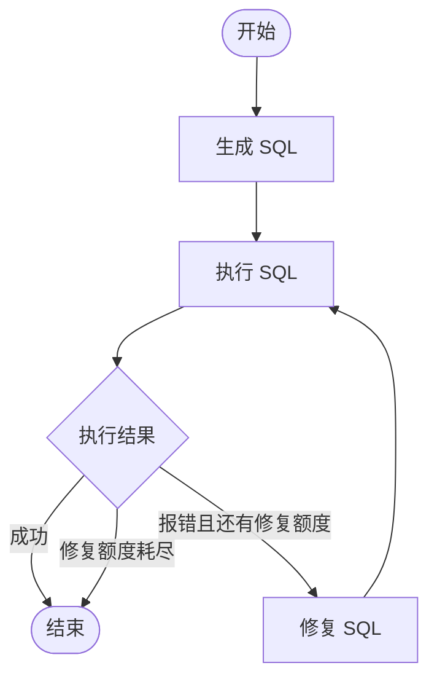

# 课程大作业 · AI 协作完整记录

记录区间为北京时间 2026-11-11 22:37:13 至 2026-11-20 12:42:21。共 35 条用户发言和 72 条 AI 可见发言，按原会话顺序排列。

原消息中的 API 密钥以“[已隐去 API 密钥]”标示。

附件路径中的微信账号标识以“[已隐去微信账号标识]”标示。

---

<a id="turn-001"></a>

## 001 · 用户 · 2026-11-11 22:37:13

现在把咱们这次课程大作业的具体要求发给大家：

（1）选定具体切入点：从我讲过的这七次课里，任选一个非常具体的知识点作为你的课题（比如 H3 空间编码，或者探讨 Workflow 工作流与 Agent 智能体的真实界限等）。切记不要选太宽泛的大题目，切入点越小、越具体越好。

（2）做出原创性探索：基于你选定的这个知识点，去做一些有原创性的延伸和创新。你可以去挖一下这个细分方向目前最前沿的技术演进和行业争议，更重要的是提出你自己的改进思路、新玩法或实验验证，最终形成一份完整的实验报告。

（3）全流程记录 AI 协作：这次作业非常鼓励大家深度使用 AI，但有一个硬性要求——你需要把你和 AI 讨论、推导、完成这份报告的全部完整聊天记录，导出保存为 Markdown（.md）格式的文件，并上传到你自己的 GitHub 仓库里。

（4）报告提交与核查：你的实验报告里需要对你提出的“原创创新点”进行非常详尽、清晰的拆解和描述；同时，务必把第（3）步里的 GitHub 仓库链接直接贴在报告显著位置（注意把仓库设为 Public 公开，确保我能直接点开）。我会逐个点进去看你们的对话过程和报告并给出评分。 根据以上要求帮我给出大作业的具体思路

---

<a id="turn-002"></a>

## 002 · AI · 2026-11-11 22:38:55

我先围绕“H3 空间编码”和“Workflow 与 Agent 的界限”查一下近期资料，再把题目收敛成能实际做实验、清楚展示原创点的方案，并考虑完整聊天记录和报告的提交方式。

---

<a id="turn-003"></a>

## 003 · AI · 2026-11-11 22:40:23

你更想做哪个方向？我会先按“有基础 Python 能力、约一周完成”设计可执行方案。

- H3：空间数据实验，结果直观、无需大模型接口
- Workflow / Agent：AI 系统对比，需要调用大模型
- 暂时没偏好，优先容易做出扎实结果的题目

---

<a id="turn-004"></a>

## 004 · AI · 2026-11-11 22:40:31

目前两个方向都能收敛成可验证的小问题：H3 可以研究“围栏边界附近的点为什么会被误判”，Workflow / Agent 可以研究“出现什么错误后，才值得让模型决定下一步”。实验需要给已有的覆盖方法、带重试和分支的工作流设置合理对照，才能说明自己的改进是否有效。

---

<a id="turn-005"></a>

## 005 · 用户 · 2026-11-11 22:40:40

Workflow / Agent：AI 系统对比，需要调用大模型

---

<a id="turn-006"></a>

## 006 · AI · 2026-11-11 22:43:13

你选 Workflow / Agent 后，我建议把题目定为“SQL 查询报错后的修复”。三种方案共享同一次初始 SQL 和报错，再比较固定纠错、Agent 自主修复和失败后接管，能更公平地看出控制方式的影响。评分也要区分“SQL 能执行”和“查询结果正确”；后者用预先准备的标准结果核验。

---

<a id="turn-007"></a>

## 007 · AI · 2026-11-11 22:45:12

既然你更倾向 **Workflow / Agent 对比**，我建议直接选这个题目：

**《SQL 报错后，何时需要 Agent？——“固定修复一次后接管”机制的对照实验》**

它把老师提出的“Workflow 与 Agent 的真实界限”收敛到一个具体问题：**查询失败以后，继续执行预设的纠错步骤，还是让模型自主决定下一步，哪种更划算？** 有明确任务、可量化结果，也方便展示自己的改进。

**1．研究哪个知识点**

核心是“下一步行动由谁决定”。

Workflow 按预先写好的路径运行；Agent 根据反馈，动态决定使用什么工具、先做什么、何时结束。这是 Anthropic 和 LangGraph 官方资料采用的主要区分。因此，**有循环、能重试、调用了工具，都不足以单独证明一个系统是 Agent。**[Anthropic 官方说明](https://www.anthropic.com/research/building-effective-agents)、[LangGraph 官方文档](https://docs.langchain.com/oss/python/langgraph/workflows-agents)

你的实验就研究这部分控制权什么时候值得交给模型。

**2．做一个什么具体任务**

搭建一个小型“订单查询助手”：用户用自然语言提问，模型生成 SQL，到本地 SQLite 数据库里查询。

数据库只需要三张模拟表：订单表、用户表、退款表。例如：

- “统计十月份已支付订单的总金额。”
- “按用户统计消费金额，返回前五名。”
- “计算各类商品扣除退款后的实际收入。”

使用合成数据即可，不需要爬虫和真实商业数据。所有实验只做查询。

为每道题独立编写标准 SQL，保存正确结果，用于最后评分。**标准答案只给评分程序看，不能参与 Agent 的修复决策。**

**3．比较三种方案**

让三组共享**同一次初始 SQL 和执行反馈**，然后比较报错后的处理方式，减少首次生成结果不同带来的干扰。

| 方案 | SQL 报错后如何处理 | 下一步由谁决定 |
|---|---|---|
| W：固定纠错 Workflow | 获取表结构 → 查看相关数据样本 → 模型修改 SQL → 再次执行；允许有限重试 | 代码规定顺序 |
| A：自主修复 Agent | 模型决定查表结构、看样本、修改查询、再次执行或停止 | 模型动态选择 |
| H：你提出的接管方案 | 先固定修复一次；仍然报错，再交给 Agent | 规则决定接管时机，模型决定接管后的行动 |

这里的 A 是“自主修复 Agent”，研究范围只覆盖**失败后的恢复阶段**。

固定工作流也要有合理的纠错能力，包括读取表结构、接收报错和多次修复。这样才能判断自主决策是否带来了额外价值。

**4．你的原创探索放在哪里**

建议把贡献集中在两个可拆解的设计上。

第一，**延迟释放控制权**。简单错误先用固定流程处理，修复失败后才启用自主决策。你提出的假设是：

> 一次固定修复能解决部分简单错误；只让剩余错误进入 Agent，可能以较少的调用成本，获得接近自主修复方案的正确率。

第二，**重复失败时提前退出**。记录“执行的 SQL＋错误类型”；同一组合连续重复达到预设次数，就结束修复并报告失败，避免耗尽预算。

为了确认每个设计是否有效，可以追加两个小实验：

- 把“固定修复一次”改成“两次”，观察接管是否过晚。
- 去掉“重复失败退出”，观察是否增加无效调用。

这类“每次只去掉或改变一个设计”的实验，能帮助你解释效果来自哪里。

**原创性应表述为你设计并验证了具体接管规则，以及它的适用条件。** 混合 Workflow 与 Agent 已有实践，不能直接声称自己首次提出了这种架构。

**5．实验怎么安排**

按约一周的工作量，建议先做：

- **10 道开发题**：调试工具、提示词和接管规则。
- **30 道正式测试题**：覆盖条件筛选、分组统计和少量多表查询。
- 每道正式题重复运行 **3 次**，三种策略最多形成 **270 条策略运行记录**。

正式测试前锁定题目和规则。三组使用同一个模型、相同工具和统一预算，例如最多四次修复阶段的模型调用；H 在接管前已经消耗的次数，也计入总预算。实际 token 和耗时另外记录。

重点测这些指标：

| 指标 | 要回答的问题 |
|---|---|
| 最终结果正确率 | 最后是否查对了？ |
| 首次报错题目的修复成功率 | 出错以后救回了多少题？ |
| 执行成功但结果错误的比例 | 是否出现“能运行，却算错了”？ |
| 实际 token、工具调用次数、耗时 | 为修复付出了多少成本？ |
| H 的接管比例 | 有多少错误确实进入了 Agent？ |

**SQL 能执行，不代表结果正确。** 最后要与标准查询结果比较，不能只看是否报错，也不要把“返回空表”自动判成失败。官方 Agent 评估资料同样强调，应检查实际结果，并通过重复运行观察波动。[Anthropic 评估指南](https://www.anthropic.com/research/demystifying-evals-for-ai-agents)

如果自然报错很少，就如实报告“在本任务范围内，固定流程已经足够”。这也是边界结论；额外增加的困难测试集应单独说明。

**6．最后报告重点写什么**

报告的主线可以按这个顺序展开：

1. **研究问题**：SQL 出错后，自主决策的收益是否值得其成本？
2. **相关工作**：Workflow、Agent 和已有错误恢复方法。
3. **你的方案**：接管条件、传递给 Agent 的信息、预算和退出条件。
4. **实验设置**：数据、题目、三组实现、评分方法与公平性控制。
5. **实验结果**：正确率、修复率、成本及波动。
6. **案例分析**：选取固定流程成功、Agent 成功、双方都失败的真实案例。
7. **局限与结论**：哪些错误值得接管，哪些任务用固定流程已经足够。

尤其要把第三部分写透：**什么情况下触发、触发后改变了哪些决策权限、为什么这样设计，以及哪个实验能验证它。**

**7．AI 协作与 GitHub 从现在开始记录**

建议仓库包含：

```text
README.md          项目介绍、报告入口、复现方法
report.md          实验报告
chatlogs/          完整 AI 聊天记录，Markdown 格式
src/               三种方案和评分程序
data/              数据生成方式、测试题和标准答案
results/           原始运行记录、汇总结果和图表
```

课程协作聊天和程序实验日志都要保存：前者展示你怎样讨论、质疑和修改方案，后者支持实验结果复核。**完整聊天记录应来自实际对话，保留被否决的方案、纠错和失败过程，不能用事后生成的总结替代。**

最终将仓库设为 **Public**，把实际仓库链接放在报告首页显著位置。

这个题目最有价值的成果，是用数据回答：**在这个具体任务里，什么时候值得把下一步交给模型决定。**

---

<a id="turn-008"></a>

## 008 · 用户 · 2026-11-11 22:50:32

LangGraph和workflow是什么东西

---

<a id="turn-009"></a>

## 009 · AI · 2026-11-11 22:50:37

我查一下 LangGraph 的官方说明，再结合刚才的作业方案解释这两个概念。

---

<a id="turn-010"></a>

## 010 · AI · 2026-11-11 22:51:17

**Workflow 是“怎样安排任务步骤”；LangGraph 是“把这些步骤组织成程序的一种工具”。**

拿刚才的“数据库查询助手”举例，就容易理解了。

**Workflow，中文叫“工作流”。** 你提前规定好任务的处理步骤，例如：

```text
用户提问 → AI 写查询语句 → 数据库执行
                            ↓
                    成功：返回结果
                    报错：让 AI 修改后再执行
```

这就是一个工作流。它可以包含分支、循环和重试，也可以在某个步骤调用 AI。普通的“提交报销 → 主管审批 → 财务付款”同样是工作流。

**LangGraph 是一个编程框架，用来连接、运行和管理这些步骤。** 它把流程表示成一张“图”，这里的图指步骤之间的连接关系。主要有三个概念：

| 概念 | 通俗解释 | 查询助手中的例子 |
|---|---|---|
| 节点 Node | 一个处理步骤 | 生成查询、执行查询、修改查询 |
| 边 Edge | 下一步去哪里 | 执行成功就结束，报错就进入修复 |
| 状态 State | 流程中保存的信息 | 用户问题、查询语句、报错、已重试次数 |

它还能帮助保存执行进度、暂停等待人工处理，以及恢复运行。[LangGraph 官方介绍](https://docs.langchain.com/oss/python/langgraph/overview)

再把 **Agent，智能体** 放进来，你就能看清它们的关系：

- **Workflow 的做法**：程序规定“报错以后，先看表结构，再修改查询”。
- **Agent 的做法**：模型看到报错后，自主判断“我该先检查表结构，还是查看数据样本，或者直接修改查询”。

区别主要在于**下一步行动有多少由模型动态决定**。LangGraph 既能搭建预设工作流，也能搭建 Agent，还能把两种方式结合起来。[官方概念说明](https://docs.langchain.com/oss/python/langgraph/workflows-agents)

对于你的大作业，研究对象是 **“固定流程与模型自主决策的效果差别”**。LangGraph 可以作为实现工具；起步时也可以先用普通 Python 把这两种处理方式写出来。

---

<a id="turn-011"></a>

## 011 · 用户 · 2026-11-11 22:59:23

详细介绍一下LangGraph是干啥的，怎么用的

---

<a id="turn-012"></a>

## 012 · AI · 2026-11-11 22:59:29

我会沿用“数据库查询助手”的例子，解释 LangGraph 怎样组织步骤、保存执行信息，并给出一个不需要模型接口密钥就能运行的入门示例。

---

<a id="turn-013"></a>

## 013 · AI · 2026-11-11 23:02:00

官方文档里最关键的三个概念是“节点、连接和共享状态”：节点处理事情，连接决定接下来去哪，状态保存问题、结果和报错。入门示例会用真实数据库演示“执行失败 → 修复 → 再执行”；其中的 SQL 生成和修复先用固定代码模拟，便于看清 LangGraph 本身的作用。

---

<a id="turn-014"></a>

## 014 · AI · 2026-11-11 23:03:34

**LangGraph 是一个用来组织和运行多步骤 AI 程序的框架。** 你把任务拆成步骤，规定步骤之间怎么连接、共享哪些信息，它负责推动整个流程运行。

大模型负责理解问题、生成内容或选择行动；LangGraph 负责安排这些能力与数据库、搜索等工具怎样配合。它支持固定工作流，也支持 Agent，以及两者混合的系统。[官方介绍](https://docs.langchain.com/oss/python/langgraph/overview)

下面沿用你的“数据库查询助手”，从用途讲到代码。

**先看它解决什么问题。**

假设用户问：“所有订单的总金额是多少？”

一个完整程序可能需要：

1. 读取数据库的表结构。
2. 让大模型生成 SQL 查询语句。
3. 在数据库中执行。
4. 如果报错，把错误交给模型修复。
5. 再执行；超过修复次数就停止。
6. 保存过程，方便检查哪里出了问题。

普通 Python 也能实现这些步骤。随着分支、循环、暂停和恢复增加，LangGraph 能帮助你把流程和执行状态组织清楚。

这个查询助手可以画成：



这里的“图”，就是**步骤和步骤之间的连接关系**。

**理解 LangGraph，先掌握三个核心概念。**

| 概念 | 含义 | 查询助手中的例子 |
|---|---|---|
| State：状态 | 各步骤共享的信息 | 用户问题、SQL、报错、查询结果、修复次数 |
| Node：节点 | 执行一项工作的函数 | 生成 SQL、执行 SQL、修复 SQL |
| Edge：边 | 决定下一步运行哪个节点 | 执行成功就结束，失败就进入修复 |

节点读取状态、完成工作，然后返回需要更新的字段；边把这些节点连成顺序、分支或循环。[Graph API 官方说明](https://docs.langchain.com/oss/python/langgraph/graph-api)

例如，当前状态可以理解成一本任务记录本：

```python
{
    "question": "所有订单的总金额是多少？",
    "sql": "SELECT SUM(total_price) FROM orders",
    "error": "no such column: total_price",
    "rows": [],
    "repairs": 0
}
```

修复节点看见报错后，返回：

```python
{
    "sql": "SELECT SUM(amount) FROM orders",
    "repairs": 1
}
```

LangGraph 会将这两个字段更新到状态中。其他没有返回的字段继续保留。

这里有一个容易混淆的地方：**状态更新默认是覆盖对应字段。** 如果你希望聊天消息不断追加，需要配置相应的合并规则；聊天场景可以使用框架提供的 `MessagesState`。

**实际使用时，基本就是五步。**

1. 定义状态里保存哪些字段。
2. 编写每个节点的处理函数。
3. 添加节点。
4. 用普通边、条件边连接节点。
5. 编译，然后传入初始状态运行。

官方的 Graph API 构建流程也是围绕这些步骤展开的。[官方构建指南](https://docs.langchain.com/oss/python/langgraph/use-graph-api)

下面是一份完整入门示例。它使用真实的 SQLite 数据库，**SQL 生成和修复先用固定代码模拟，因此不需要模型接口密钥**。

为了展示纠错路径，示例故意在首次查询里使用错误字段。这只是教学演示；正式实验应记录模型实际产生的错误。

先安装：

```bash
python -m pip install -U langgraph
```

将下面代码保存为你新建的 Python 文件，再用 Python 运行：

```python
import sqlite3

from typing_extensions import TypedDict
from langgraph.graph import StateGraph, START, END


# 准备一个小型数据库：三笔订单，总金额为 100
db = sqlite3.connect(":memory:")
db.execute("CREATE TABLE orders (amount INTEGER)")
db.executemany(
    "INSERT INTO orders VALUES (?)",
    [(20,), (35,), (45,)],
)


# 1. 定义共享状态
class State(TypedDict):
    question: str
    sql: str
    error: str
    rows: list
    repairs: int


# 2. 定义节点
def generate_sql(state: State):
    # 模拟首次生成：故意使用不存在的字段
    return {"sql": "SELECT SUM(total_price) FROM orders"}


def execute_sql(state: State):
    print("执行：", state["sql"])

    try:
        rows = db.execute(state["sql"]).fetchall()
        return {"rows": rows, "error": ""}
    except sqlite3.Error as exc:
        print("报错：", exc)
        return {"rows": [], "error": str(exc)}


def repair_sql(state: State):
    # 模拟修复：实际项目中，这里可以调用大模型
    repairs = state["repairs"] + 1
    print("进入修复，第", repairs, "次")

    return {
        "sql": "SELECT SUM(amount) FROM orders",
        "repairs": repairs,
    }


# 条件函数只负责决定下一步去哪里
def route_after_execution(state: State):
    if not state["error"]:
        return "finish"

    if state["repairs"] >= 2:
        return "finish"

    return "retry"


# 3. 添加节点
builder = StateGraph(State)
builder.add_node("generate", generate_sql)
builder.add_node("execute", execute_sql)
builder.add_node("repair", repair_sql)

# 4. 连接节点
builder.add_edge(START, "generate")
builder.add_edge("generate", "execute")

builder.add_conditional_edges(
    "execute",
    route_after_execution,
    {
        "finish": END,
        "retry": "repair",
    },
)

builder.add_edge("repair", "execute")

# 5. 编译并运行
app = builder.compile()

result = app.invoke({
    "question": "所有订单的总金额是多少？",
    "sql": "",
    "error": "",
    "rows": [],
    "repairs": 0,
})

print("最终结果：", result["rows"])
print("修复次数：", result["repairs"])

db.close()
```

预期输出为：

```text
执行： SELECT SUM(total_price) FROM orders
报错： no such column: total_price
进入修复，第 1 次
执行： SELECT SUM(amount) FROM orders
最终结果： [(100,)]
修复次数： 1
```

看这段代码时，重点抓住以下几处：

- `StateGraph(State)`：创建流程，并指定共享状态的结构。
- `add_node(...)`：注册一个处理步骤。注册时不会立即执行。
- `add_edge(...)`：规定固定的下一步。
- `add_conditional_edges(...)`：根据状态选择下一步。
- `compile()`：检查并生成可运行的图。
- `invoke(...)`：传入初始状态，启动一次运行，取得最终状态。

**接入真正的大模型时，主要替换节点内部的实现。**

上面的流程结构可以继续保留。你需要改写两个函数：

| 节点 | 发给模型的信息 | 模型返回的内容 |
|---|---|---|
| `generate_sql` | 用户问题、数据库表结构 | 查询 SQL |
| `repair_sql` | 用户问题、表结构、原 SQL、执行报错 | 修复后的 SQL |

数据库执行节点仍然用数据库程序完成。

例如，修复节点发给模型的信息可能是：

```text
用户问题：所有订单的总金额是多少？

表结构：
orders(amount INTEGER)

原 SQL：
SELECT SUM(total_price) FROM orders

执行错误：
no such column: total_price

请返回修复后的 SQL。
```

模型返回新 SQL 后，节点把它写进 `state["sql"]`，LangGraph 再沿着边进入执行节点。具体模型的初始化和调用方式，取决于你选用的模型接口；LangGraph 本身可以独立于 LangChain 使用。[官方说明](https://docs.langchain.com/oss/python/langgraph/overview)

**那怎样用它搭建 Agent？**

刚才的示例里，修复顺序由代码规定，所以属于工作流。

如果要实现自主修复 Agent，可以给模型提供几个工具：

- 查看数据库有哪些表。
- 查看指定表的字段。
- 查看少量数据样本。
- 执行只读 SQL。

然后构建这样的循环：

```text
模型根据当前信息选择行动
          ↓
程序执行它选中的工具
          ↓
把工具结果交回模型
          ↓
模型继续选择行动，或者给出最终答案
```

例如，模型看到“字段不存在”，可能先选择“查看表结构”，再生成新 SQL；看到类型问题，可能先查看数据样本。

LangGraph 负责运行这个循环、保存消息和结果。**自主选择行为来自模型，工具的实际执行由程序完成。** 官方入门教程中的计算器 Agent 就展示了“模型 → 工具 → 模型”的循环。[官方 Agent 示例](https://docs.langchain.com/oss/python/langgraph/quickstart)

**当流程变复杂时，它还有几个实用能力。**

| 能力 | 实际用途 |
|---|---|
| 保存执行进度 | 长任务中保存状态，支持后续恢复 |
| 人工介入 | 运行到某一步暂停，让人检查或补充信息 |
| 流式输出 | 执行过程中显示节点进展或模型输出 |
| 并行与子图 | 同时运行独立任务，或把一段流程封装后复用 |

其中，保存进度需要配置 **checkpointer（检查点保存器）**。`InMemorySaver` 适合进程内演示；需要程序关闭后仍保留进度时，应使用持久化存储，并通过 `thread_id` 区分不同会话。[状态保存说明](https://docs.langchain.com/oss/python/langgraph/persistence)

人工介入可以用 `interrupt()` 暂停，再提供外部输入恢复运行。它也依赖检查点和会话标识。[人工介入说明](https://docs.langchain.com/oss/python/langgraph/interrupts)

流式输出则可以让用户在等待时看到“正在查询”“正在修复”等进展。[流式输出说明](https://docs.langchain.com/oss/python/langgraph/streaming)

对于你的大作业，建议按这个顺序学习：**先运行上面的例子，理解状态、节点、条件边和循环；再接入大模型；最后实现 Agent 自主选工具。**

这样，三种实验方案就能共享相同的数据库和模型，只改变报错后的控制方式：

- W：沿固定纠错步骤运行。
- A：进入模型自主选工具的循环。
- H：先固定修复一次，失败后进入自主修复循环。

你的研究贡献放在这些控制规则和实验结果上，LangGraph 用来帮助你清楚地实现、运行和检查它们。

---

<a id="turn-015"></a>

## 015 · 用户 · 2026-11-11 23:34:31

它的作用是帮忙写代码吗

---

<a id="turn-016"></a>

## 016 · AI · 2026-11-11 23:34:52

**它主要负责组织和运行程序里的各个步骤。代码需要你自己写，或者让 AI 编程助手帮你写。**

拿你的作业举例：

- **AI 编程助手**：帮你写出“生成查询”“执行查询”“修复错误”这些函数。
- **LangGraph**：把这些函数连接起来，控制先运行哪个、报错后去哪里、什么时候停止。
- **大模型**：在程序运行时，负责生成 SQL、分析错误或选择下一步行动。

可以把 LangGraph 理解成**流程调度员**：你把各个步骤准备好，它按照你设计的规则安排执行。

也可以用它搭建一个“自动写代码的 Agent”，但写代码的能力来自接入的大模型，LangGraph 负责组织整个过程。

---

<a id="turn-017"></a>

## 017 · 用户 · 2026-11-11 23:37:52

为什么不自己直接在代码里把流程写好呢

---

<a id="turn-018"></a>

## 018 · AI · 2026-11-11 23:38:29

**完全可以。就你现在的大作业，第一版直接用 Python 写流程很合适。** LangGraph 是可选工具。

比如“生成 SQL → 执行 → 报错后修复”，自己写一个循环就够了：

```python
sql = generate_sql(question)

for _ in range(3):
    result, error = execute_sql(sql)

    if error is None:
        break

    sql = repair_sql(sql, error)
```

这已经是一个工作流了。

LangGraph 的价值主要出现在流程逐渐复杂以后：

| 遇到的需求 | 自己写需要处理什么 | LangGraph 能提供什么 |
|---|---|---|
| 多个分支和循环 | 管理各处跳转与退出条件 | 用节点和连接统一表达流程 |
| 中途暂停，之后继续 | 保存进度、读取进度、恢复执行 | 配置检查点后管理执行状态 |
| 等待人工检查 | 保存现场，收到回复后接着运行 | 暂停和恢复机制 |
| 查看每一步发生了什么 | 自行设计执行过程的记录方式 | 提供状态和执行事件接口 |

这些能力自己都能实现。使用框架，是为了减少需要自己维护的通用功能；同时也会增加学习成本和依赖。[官方能力介绍](https://docs.langchain.com/oss/python/langgraph/overview)

**所以，你的大作业可以先不用 LangGraph。** 用普通 Python 分别实现固定工作流、自主修复 Agent、失败后接管三种方案，就能研究它们的区别。

即使都写在一个 Python 文件里，只要其中一种方案让模型根据反馈自主选择下一步工具，它仍然可以是 Agent。**是否使用 LangGraph，与是否属于 Agent，是两个不同的问题。**

---

<a id="turn-019"></a>

## 019 · 用户 · 2026-11-18 15:26:41

这大作业，目前最前沿的技术演进和行业争议有哪些，我可以往哪些方向思考

---

<a id="turn-020"></a>

## 020 · 用户 · 2026-11-18 15:29:02

这次课程大作业的具体要求：
（1）选定具体切入点：从我讲过的这七次课里，任选一个非常具体的知识点作为你的课题（比如 H3 空间编码，或者探讨 Workflow 工作流与 Agent 智能体的真实界限等）。切记不要选太宽泛的大题目，切入点越小、越具体越好。
（2）做出原创性探索：基于你选定的这个知识点，去做一些有原创性的延伸和创新。你可以去挖一下这个细分方向目前最前沿的技术演进和行业争议，更重要的是提出你自己的改进思路、新玩法或实验验证，最终形成一份完整的实验报告。
（3）全流程记录 AI 协作：这次作业非常鼓励大家深度使用 AI，但有一个硬性要求——你需要把你和 AI 讨论、推导、完成这份报告的全部完整聊天记录，导出保存为 Markdown（.md）格式的文件，并上传到你自己的 GitHub 仓库里。    这次大作业，目前最前沿的技术演进和行业争议有哪些，我可以往哪些方向思考

---

<a id="turn-021"></a>

## 021 · AI · 2026-11-18 15:30:54

我会沿着你选的 Workflow / Agent 方向，查近期论文和一线团队的技术报告，再把其中的争议落到你能用 Python 和 SQLite 验证的小问题上。

---

<a id="turn-022"></a>

## 022 · AI · 2026-11-18 15:34:57

结合你前面问的“为什么不直接用 Python 把流程写好”，我最推荐把大作业定为 **《同一个 SQL 错误出现两次时，应该让 Agent 接管吗？》**

这个问题正好落在 Workflow 与 Agent 的边界上。假设数据库提示“找不到 `total_price` 这一列”，第一次报错时，程序可以按固定步骤查表结构、让模型改写 SQL、重新执行。如果第二次仍然找不到同一列，继续按原步骤修还有用吗？此时让模型自己决定去查哪张表、看哪些字段，能否用更少的尝试解决问题？**这就是你可以亲手验证的争议。**

截至 **2026 年 11 月 18 日**，这个方向有三条与你的作业特别相关的技术演进。

| 前沿方向 | 已有工作发现了什么 | 你可以研究的具体问题 |
|---|---|---|
| **1．什么时候值得让 Agent 接管？** | 2026 年 11 月的 *LuthorSQL* 预印本让本地模型先处理问题，仅在把握不足时交给较慢的 Agent。作者报告，在一组 227 道题上，两种方案取得相同准确率，按需接管节省了 33.3% 的 API 费用。这个数字对应论文的模型组合与测试集。[论文原文](https://arxiv.org/abs/2611.17780) | 论文用模型的置信度决定接管。你可以测试一个更容易实现、也更容易解释的信号：**数据库是否连续两次报告同一列出错？** |
| **2．该由程序规定查什么，还是让模型自己找证据？** | Vercel 简化了内部 SQL 助手的专用工具，让模型直接查阅整理好的业务文档。五道内部测试题从答对四道变为五道，样本很小，团队也强调文档质量是前提。COLM 2026 的 *FlexSQL* 则允许模型在解题过程中随时查看表结构、数据值和验证结果，研究场景是复杂分析数据库。[Vercel 工程复盘](https://vercel.com/blog/we-removed-80-percent-of-our-agents-tools) · [FlexSQL 论文](https://arxiv.org/abs/2605.02815) | 给两组**相同的表结构、样本和工具**。一组每次报错都按固定顺序查看，另一组让模型自己选。只为修一个拼错的列名，Agent 能省掉几步？涉及两张表时，结果会变化吗？ |
| **3．SQL 跑通了，什么时候还应该问用户？** | 2026 年 10 月的 *Beyond Correctness* 预印本发现，模型有时已经识别出问题有歧义，却在澄清前提交了答案。即便碰巧算对，也可能猜错用户真正关心的口径。研究者要求模型把待澄清的问题逐项处理，在其测试中减少了这类失败。[论文原文](https://arxiv.org/abs/2610.02739) | 只研究“销售额是否扣除退款”这一个歧义。比较直接回答、每次都追问、仅在口径不明确时追问三种做法，同时统计**答对多少题、多问了多少次**。这个方向更偏产品体验。 |

**我会选方向 1。** 它可以沿用你已经理解的 Python 循环和 SQLite 数据库。你的原创贡献可以写得很具体：**设计一条根据报错内容决定接管时机的规则，并测出它在哪些错误上有效、在哪些错误上会误判。** 实验只需抓住四件事。

1. **先把接管规则写死。** 第一次遇到“找不到列”时，固定流程查表结构、改写 SQL、再执行。如果再次提示找不到**同一个列名**，就让 Agent 自己选择下一步。如果列名或错误类型变了，继续固定修复，直到统一的尝试上限。判断依据全部来自运行时能看到的报错。
2. **设置能检验这条规则的对照。** 比较“始终固定修复”“首次报错就交给 Agent”“固定修复一次后只要仍报错就接管”和“仅在同一列重复报错时接管”。其中最后两组最值得比：它们能告诉你，**读懂错误内容，比单纯数失败次数多带来了什么**。各组从同一道题、同一条初始 SQL、同一次报错出发，使用同一模型、工具和总预算。
3. **同时看结果和代价。** 记录每组修对几题、调用模型几次、消耗多少 token。用独立编写的标准查询核对答案。例如，题目要求“已支付订单总额”，修复后的 SQL 若漏掉“已支付”，它可能顺利执行，却把未支付订单也算了进去。测试数据里放一笔未支付订单，就能让这种错误显现。
4. **把反例当成研究结果。** 同一个错误重复出现，也可能只是一个普通拼写问题，固定流程第三次就能修好。记录这种“接管了却没获益”的案例，再和“Agent 查到正确字段后成功修复”的案例并排分析。如果自然测试里重复错误很少，就报告实际频率，把专门构造的重复错误另列为压力测试。这样既能说明规则有没有用，也能说明它平时有多少机会发挥作用。

最后，老师要求的**完整 AI 协作记录从这次选题讨论就已经开始了**。把实际对话按时间顺序保存为 `.md`，包括你追问“为什么不用普通 Python”、后来怎样提出接管条件，以及实验后有没有推翻最初想法。提交时把这些记录上传到自己的 **Public GitHub 仓库**，在报告首页放上可点击的仓库链接。老师就能从你的第一个疑问，一直看到它怎样变成一条可检验的规则。

---

<a id="turn-023"></a>

## 023 · 用户 · 2026-11-18 20:01:34

# Files mentioned by the user:

## 第7讲_课时1_质量良好是怎么来的 (1).pptx: D:/xwechat_files/[已隐去微信账号标识]/msg/file/2026-11/第7讲_课时1_质量良好是怎么来的 (1).pptx

## 第7讲_课时2_一个周末烧掉几十倍账单 (1).pptx: D:/xwechat_files/[已隐去微信账号标识]/msg/file/2026-11/第7讲_课时2_一个周末烧掉几十倍账单 (1).pptx

## 第7讲_课时3_六讲兵器装上一面工具墙 (1).pptx: D:/xwechat_files/[已隐去微信账号标识]/msg/file/2026-11/第7讲_课时3_六讲兵器装上一面工具墙 (1).pptx


## My request:
根据老师给的ppt，找出五个切入点

---

<a id="turn-024"></a>

## 024 · AI · 2026-11-18 20:01:42

我会对照三份课件的具体页码，挑出五个能单独做成小实验的知识点，并说明每个题目可以改什么、怎么验证。

---

<a id="turn-025"></a>

## 025 · AI · 2026-11-18 20:03:21

我建议优先选 **①“坏旗率升高到什么程度，才值得让 Agent 接手排查？”**。它直接接上了你之前问的“为什么不把流程写在 Python 里”，也用到了老师课件中的海洋质检案例。如果你更想选一个代码量小、容易验证的题目，选 **②“空结果究竟代表什么？”**。

下面五个题目都能在课件里找到具体出处。每个题目只改一项机制，方便你在报告里讲清楚自己的贡献。

| 切入点 | 老师课件中的依据 | 你可以做的原创实验 |
|---|---|---|
| **① 坏旗率升高时，什么时候让 Agent 接手？** | 课时 1 第 5–7 页讲“常规走工作流，异常召智能体”。课时 3 第 2、5 页给出坏旗率从 4% 升至 18%、异常集中在 S07 温度传感器的案例。 | 用模拟站点数据比较三种策略：固定流程排查、每次都让 Agent 排查、满足条件才让 Agent 接手。你设计的接管条件可以是“坏旗率升高，且有效观测数足够”。比较**异常站点定位正确率、漏掉的异常数、模型调用次数**。 |
| **② 查询返回 `[]`，助手能区分“没有数据”和“没有异常”吗？** | 课时 1 第 2、13 页中，非法区域参数被处理成空列表，助手连续查了三次，最后写出“质量良好”。 | 准备三类查询：区域名写错、区域合法但当月无观测、有观测且坏旗数为零。对同一批问题，比较工具“只返回列表”和“同时返回查询状态、观测数、坏旗数”两种设计。重点统计**前两类被误报为质量良好的次数**，再检查真正无异常的案例能否被正确报告。 |
| **③ 重算任务超时后，怎样避免重复提交，又允许真正的新任务？** | 课时 1 第 14 页讲幂等键，即让同一操作重试时只生效一次。课时 3 第 6 页演示 S07 重算已提交、回执超时，再次提交时返回原作业。 | 用 Python 和 SQLite 模拟“任务已入库，但调用方没收到回执”。比较无幂等键、只按参数去重、按“任务 ID＋步骤＋规范化参数”去重。专门加入**同一次任务的重试**和**用户稍后主动发起相同参数的新任务**。同时统计重复创建数和被误拦的新任务数。 |
| **④ “连续失败三次就停”，会不会停得太早或太晚？** | 课时 2 第 2、7 页用损坏文件反复解析引出停机条件，第 13 页展示第三次同类错误触发人审的轨迹。 | 模拟两类外观相似的失败：一次短暂超时后可以恢复，以及文件损坏、继续解析仍会失败。比较“所有错误最多试三次”和“依据工具实际返回的错误类型决定是否重试”。测**最终处理成功率、无效调用次数、原本可恢复却被提前放弃的比例**。 |
| **⑤ 结果表已经存在，能证明本次重算完成了吗？** | 课时 3 第 4、9–10 页要求用作业状态和实际产物验证“已完成”。课堂案例里，备注已写入，但重算作业仍在运行。 | 在课堂案例上增加一个反例：**昨天的结果表还在，今天的作业尚未完成**。比较“模型自行宣布完成”“检查结果表存在”“核对本次作业 ID、成功状态和对应产物”三种收尾方式。测**错误宣告完成率**，同时检查真正完成的任务能否正常通过。 |

**如果选①，最值得做的是一对很小的对照样本。** 假设甲站有 5 条观测、1 条坏旗，乙站有 500 条观测、100 条坏旗，坏旗率都是 20%。只看比例，两站会触发同一条规则。你可以追问：甲站是否应该先补查观测覆盖情况，乙站是否值得立即让 Agent 排查坏旗集中在哪个传感器？再加入一个“样本虽少，但确实出了故障”的案例，就能检验自己提出的规则会不会漏报。这样，你研究的是一个明确的决策，而整套实验用普通 Python 就能实现。

三份课件共 45 页。表中页码按各课时分别计数，课件里的 4% 和 18% 是教学案例数据。写报告时，把你实际测得的结果单独列出。

课时 1　:codex-file-citation{path="D:/xwechat_files/[已隐去微信账号标识]/msg/file/2026-11/第7讲_课时1_质量良好是怎么来的 (1).pptx" artifact_kind="presentation" purpose="source"}

课时 2　:codex-file-citation{path="D:/xwechat_files/[已隐去微信账号标识]/msg/file/2026-11/第7讲_课时2_一个周末烧掉几十倍账单 (1).pptx" artifact_kind="presentation" purpose="source"}

课时 3　:codex-file-citation{path="D:/xwechat_files/[已隐去微信账号标识]/msg/file/2026-11/第7讲_课时3_六讲兵器装上一面工具墙 (1).pptx" artifact_kind="presentation" purpose="source"}

---

<a id="turn-026"></a>

## 026 · 用户 · 2026-11-18 23:22:15

我选择第一个切入点，现在向我详细解释第一个切入点的实验应该怎么做，可以与港口运筹优化数学模型的建模相结合吗

---

<a id="turn-027"></a>

## 027 · AI · 2026-11-18 23:22:31

我会把实验收窄到一个港口决策：潮位观测出现坏旗时，什么时候值得让 Agent 排查，以及这次排查会不会改变泊位计划。我也会用一组能手算的小例子，把质检、接管和优化模型串起来。

---

<a id="turn-028"></a>

## 028 · AI · 2026-11-18 23:25:30

可以结合。建议把题目定为 **《潮位观测坏旗率升高时，何时值得让 Agent 排查？——以单泊位船舶调度为例》**。

老师课件里，S07 温度传感器的坏旗增多，问题是“什么时候从固定统计流程转入自主排查”。你可以保留这个知识点，把传感器换成**港口潮位仪**。这样，排查结果就关系到一个具体的运筹决策：**深吃水船现在能否进港，还是应该先让浅吃水船靠泊？** 潮汐窗口与泊位安排的联合优化已有运筹学研究，你的原创探索可以放在“什么情况下值得为排班多查一次数据”。[泊位与航道约束研究](https://pubsonline.informs.org/doi/abs/10.1287/trsc.2018.0865)

### 一、先用两条船理解整个实验

假设 08:00 有两艘船同时到港，只有一个泊位。A 船吃水深，作业需 1 小时；B 船吃水浅，作业需 2 小时。B 船随时可以进港，A 船能否在 08:00 进港取决于潮位，下一次确定可以进港是 10:00。以下数字是用来手算的模拟条件。

| 08:00 的判断 | 最优排班 | 两船总等待时间 |
|---|---|---|
| A 船可以进港 | A 在 08:00–09:00 作业，B 在 09:00–11:00 作业 | 0＋1＝**1 小时** |
| A 船只能等到 10:00 | B 在 08:00–10:00 作业，A 在 10:00–11:00 作业 | 0＋2＝**2 小时** |

现在加入质检信息：**主潮位仪最近一小时的坏旗率升高，08:00 的进港窗口有争议。** 如果备用潮位仪支持较高水位，第一套方案能少等一小时。如果独立证据支持较低水位，第一套方案在模拟条件下就不可行，表里的“1 小时”也只是名义等待时间。再换一个场景，假如当天到港的都是浅吃水船，同样的坏旗率可能完全不影响排班。

这给了你一个可以检验的假设：**坏旗率告诉你数据值不值得怀疑，排班模型告诉你这次怀疑值不值得立即排查。** 两者结合，也许能减少 Agent 调用，同时保住真正影响调度的排查机会。

### 二、准备什么数据

第一版用 **Python 生成模拟港口数据**就够了。模拟的好处是，你知道哪次真的发生了仪器偏差，也知道事后真实可行的进港时段。建议把数据分为三张表。

| 数据表 | 最少需要的字段 | 用途 |
|---|---|---|
| 潮位观测表 | 时刻、仪器编号、观测潮位、质量标记 | 算坏旗率、样本数、缺测情况 |
| 调度时可查的证据表 | 当时发布的潮位预测、同一基准面的备用仪器读数、设备维护记录及时间 | 让固定流程和 Agent 据此核验有争议的窗口 |
| 船舶计划表 | 船号、到港时刻、作业时长、进港所需最低水深 | 输入泊位优化模型 |

另外保存一份**评分用真值**，包括模拟器生成的实际潮位、注入的故障类型、各船真正可进港的时段。整个系统生成排班后才打开它评分。尤其要注意，08:00 做决策时可以查 08:00 已经发布的预测，10:00 的事后实测只能用于评分。

坏旗的定义也要写清楚。若采用 QARTOD 的水位标记，`4` 表示未通过关键质检，`9` 表示缺测。一次观测质检失败说明该数值不宜直接采用，单凭这个标记还无法判定水位高低。为简化实验，可以只生成“通过、失败、缺测”三种状态，按下面的口径计算。[QARTOD 水位质检手册](https://ioos.github.io/qartod_manuals/latest/Water_Level/)

\[
坏旗率=\frac{失败观测数}{通过观测数+失败观测数},
\qquad
覆盖率=\frac{通过观测数+失败观测数}{应有观测数}
\]

这两个数要一起保留。过去一小时应有 12 条记录，“收到 10 条、2 条失败”和“收到 5 条、1 条失败”的坏旗率都是 20%，但可用证据不同。分母为零时记为“无数据”，走单独的缺测处理流程。

### 三、怎样判断要不要让 Agent 接手

建议把实验分成四组。**前三组先回答原来的课程问题，第四组体现你加入港口运筹后的改进。**

| 组别 | 怎么处理同一个场景 | 这组用来回答什么 |
|---|---|---|
| **W：固定工作流** | 代码按预设顺序查主站、备用仪器和预测。证据冲突或不足时采用保守窗口 | 一套合理的固定规则能做到什么程度？ |
| **A：每次都由 Agent 排查** | 每个场景都由模型决定先查哪个工具、要不要继续、何时给出结论 | 自主排查能带来多少收益，花多少调用？ |
| **R：坏旗率触发** | 坏旗率超过阈值且样本量足够时交给 Agent，其余走固定流程 | 单看质检统计，能否挑出值得排查的场景？ |
| **H：坏旗率＋排班影响触发** | 满足 R 的条件后，先计算两套候选排班。只有当前最优排班用到了有争议的进港时段，才让 Agent 接手 | **把有限的排查次数留给会影响船舶安排的异常，有没有价值？** |

**H 组怎样实现**是报告最值得细写的地方。以 08:00 为例，根据当时可用的潮位预测及预先设定的误差范围，程序构造两个情形：较高估计允许 A 船进港，较低估计不允许。两种情形分别运行同一个泊位模型。取较高估计下的最优排班，再问一句：**这套排班在较低估计下仍然可行吗？** 如果仍然可行，额外排查对这次安排的价值很小。如果不可行，Agent 才去核对备用读数、最近的仪器维护记录等证据。并列最优时四组都使用同一选解规则。

Agent 只需要三个只读工具，例如“查看最近观测”“查看备用仪器”“查看维护记录”。让它输出**建议采用的证据来源、记录编号、是否仍不确定**。程序检查记录时间与有效性，再按统一规则更新进港窗口。证据仍不足就采用保守窗口。这样既保留了 Agent 自主选工具的特点，又能说清每一次排班变更依据什么。四组共享同一批证据、同一求解器和同一缺测处理规则。

### 四、港口运筹模型怎么建

第一版只建**单泊位、离散时间、带进港潮汐窗口的船舶排序模型**。把一天划成若干个小时，每艘船占用泊位的时长已知。为控制范围，假设潮位只限制船舶进港时刻，进入港池后整个作业期间水深充足，暂不考虑离港潮窗。

设 \(a_i\) 为船 \(i\) 的到港时刻，\(p_i\) 为作业时长。\(F_{it}=1\) 表示根据当前采用的证据，船 \(i\) 可以在时刻 \(t\) 进港。决策变量 \(x_{it}=1\) 表示安排船 \(i\) 在 \(t\) 开始靠泊。只保留“船已到港且能在规划期内完工”的候选开始时刻。

**目标是最小化所有船的总等待时间：**

\[
\min \sum_i\sum_t (t-a_i)x_{it}
\]

| 约束 | 数学表达 | 直观含义 |
|---|---|---|
| 每船安排一次 | \(\sum_t x_{it}=1\) | 每艘船选一个开始时刻 |
| 满足进港窗口 | \(x_{it}\le F_{it}\) | 窗口关闭时不能安排这艘船进港 |
| 泊位不能重叠占用 | \(\sum_i\sum_{t:\,t\le \tau<t+p_i}x_{it}\le1,\quad\forall\tau\) | 每个时段最多一艘船在作业 |

两部分的接口只有一个：**排查改变的是 \(F_{it}\)，优化模型据此计算 \(x_{it}\)**。用两三艘船调试时，普通 Python 把所有可行排法列出来就能找到最优解，还可以拿上面的手算例子核对。规划期内确实排不下的场景要记录为无可行解。

### 五、正式实验怎样跑，怎样判断结果

建议先用 **10 个开发场景**调试程序和阈值，再锁定规则，用 **40 个独立测试场景**做四组对照。每个测试场景保存固定输入，涉及大模型的策略可以重复 3 次，记录波动。测试集至少覆盖下列四种情况：

| 场景 | 它检验哪一种判断 |
|---|---|
| 坏旗率高，但船舶进港水深余量充足 | 能否省去对调度没有影响的排查？ |
| 坏旗率高，深吃水船刚好处于窗口边缘 | 能否抓住真正会改变船序的异常？ |
| 样本很少，一条坏值就让比例大涨 | 会不会把样本不足当成强证据？ |
| 坏旗率低，但仪器存在未被标记的缓慢偏差 | **只靠坏旗率触发会漏掉什么？** |

要回答题目里的“升高到什么程度”，可以在开发集上比较几个**实验候选值**。例如，把当前坏旗率与该站前七天同一时段的历史坏旗率比较，分别测试上升 **5、10、15 个百分点**才触发。5% 升到 15% 是上升 10 个百分点。根据开发集上漏掉的关键异常数和调用开销选定一个阈值，再到测试集检验。最终结论限定在你模拟的港口、仪器和船型条件下。

结果表优先放三个指标：

1. **进港窗口违规率**：将排班与隐藏真值比对，统计安排在真实窗口之外的船次。这个指标能识别例子中“名义只等一小时、实际无法执行”的方案。
2. **可行方案的总等待时间**：在各方案都生成真实可行排班的同一批场景上，逐场比较总等待时间，同时报告纳入了多少个场景。违规和无解场景另列，避免把排不下的船误算成节省等待。
3. **排查开销**：每 100 个场景触发多少次 Agent、用了多少 token、耗时多少。H 组额外求解两次的时间也要计入。

**最有说服力的一张图**是把每个策略画成一个点，横轴为每 100 个场景的 Agent 调用次数，纵轴为进港窗口违规率。再选两个真实跑出的案例做解释：一个是坏旗率相同、却因船舶吃水不同而作出不同接管决定；另一个是你的规则漏掉了异常。前者说明运筹模型为接管判断增加了什么信息，后者说明这条规则的适用边界。这样，一份报告就能同时交代清楚**课程知识点、数学模型和你自己的实验贡献**。

---

<a id="turn-029"></a>

## 029 · 用户 · 2026-11-19 13:57:12

提出与ppt内容相关的，五个细分方向目前最前沿的技术演进和五个行业争议

---

<a id="turn-030"></a>

## 030 · AI · 2026-11-19 13:57:21

我会按课件里已经选出的五个知识点，各找一项近期技术进展和一个有实际取舍的行业争议，并标出哪些证据可以用于你的港口调度选题。

---

<a id="turn-031"></a>

## 031 · AI · 2026-11-19 14:00:20

结合老师第 7 讲的三份 PPT，截至 **2026 年 11 月 19 日**，可以把相关前沿整理成下面五组。每组对应**一个具体知识点、一项技术演进、一个行业争议**。其中，与你的港口运筹选题最相关的是第 ① 项，它决定**何时排查**；第 ② 项决定**排查依据是否可靠**；第 ⑤ 项决定**怎样验证排班结果**。

### ① Workflow 与 Agent 的分工：根据什么信号交出控制权？

**课件对应：课时 1 第 5–7 页。** 老师提出“常规走工作流，异常召智能体”。前沿研究把问题推进了一步：**怎样让系统在运行中判断，这一次值得调用更昂贵的 Agent？** 2026 年 11 月的 *LuthorSQL* 先让本地模型处理查询，把低置信度问题升级给 Agent。在 227 道新题上，作者报告 API 成本下降 33.3%。之前提到的“准确率相同”需要说得更精确：两组实测为 **95.15% 和 95.59%**，在该测试集上差异未达统计显著；换到另一测试集，级联方案的准确率下降了 2 个百分点。[LuthorSQL 论文，第 8 页](https://arxiv.org/pdf/2611.17780)

**行业争议 1：应该按“系统有多不确定”，还是按“判断错误会造成多大业务损失”升级？** 两者可能给出不同选择。潮位估计很不确定，但当天只有浅吃水船，两种估计得到的排班完全一样。反过来，潮位只有小幅不确定，却恰好决定一艘深吃水船能否赶上窗口。**你的原创点就可以放在这里：对比“坏旗率触发”和“坏旗率＋排班可行性变化触发”。** 前述论文验证的是 SQL 场景，把这个思路迁移到泊位调度是你的待验证假设。按下游决策损失评价信息价值，也有运筹学依据。[Smart “Predict, then Optimize”](https://doi.org/10.1287/mnsc.2020.3922)

### ② 工具错误反馈：让 Agent 分清“没有数据”和“没有异常”

**课件对应：课时 1 第 2、11、13 页。** 课堂案例中，非法区域参数被处理成 `[]`，模型最终写出“质量良好”。近期进展是让工具返回**可由程序校验的结果，并为可恢复错误提供当前 Agent 真能执行的下一步**。2026 年版 MCP 工具规范支持结构化返回。另一项 2026 年 9 月的预印本研究发现，在其受限工具实验中，把“请在终端操作”改成调用实际可用的登录工具，凭据过期后的恢复率由 45% 升至 84%。这项实验支持的是**恢复指引要匹配工具能力**。[MCP 工具规范](https://modelcontextprotocol.io/specification/2026-07-28/server/tools) · [错误信息实验](https://arxiv.org/abs/2609.35381)

**行业争议 2：异常含义和恢复动作应该由工具预先定义多少，给模型保留多少判断空间？** 工具明确返回“应有 12 条、收到 0 条”，能避免模型把缺测解释成正常。但如果接口一律规定“空结果就重试”，合法的空查询也会反复执行。放到港口实验里，可以比较只返回“坏旗率 0%”，与同时返回“应有数、实收数、坏旗数”时，Agent 对**零观测**和**观测充足且全部通过**的误判率。海洋水位质控规范本身就把“失败”和“缺测”分开编码。[QARTOD 水位质控手册](https://ioos.github.io/qartod_manuals/latest/Water_Level/)

### ③ 幂等与持久执行：任务超时以后，系统应该重放还是继续？

**课件对应：课时 1 第 14 页、课时 3 第 6 页。** 老师用同一幂等键防止 S07 重算作业被提交两次。现在的系统进一步区分**整项任务只启动一次**和**任务内部每个步骤如何恢复**。例如，AWS Lambda 的持久执行功能可以按执行名称识别重复启动，但内部步骤默认可能执行多次。如果数据库已经写入、完成记录尚未保存就发生中断，恢复后仍可能再次写入。[AWS 持久执行与幂等说明](https://docs.aws.amazon.com/lambda/latest/dg/durable-execution-idempotency.html)

**行业争议 3：同一个请求重试时，应该返回第一次结果，还是继续完成失败的部分？** Stripe 给出了真实的设计对照。其 API v1 在执行开始后可以保存并重放首次响应，包括 `500` 错误；v2 对失败或部分失败的操作，会在可能时继续处理。前者便于复现首次结果，后者有机会把任务真正完成，但必须准确识别哪些步骤已经生效。港口里的对应问题是：**昨天的排班请求超时后重发**，与**今天船期更新后主动重新排班**，即使参数很像，也需要识别为两种不同意图。[Stripe 幂等请求说明](https://docs.stripe.com/api/idempotent_requests)

### ④ 停机条件：数失败次数，还是判断继续排查有没有希望？

**课件对应：课时 2 第 2、6–7、13 页。** 课堂给出“同类错误连续三次转人工”的规则。近期研究尝试用执行轨迹预测继续运行的价值。2026 年 10 月的 *StopLoss* 训练了一个独立监视器，读取 Agent 最近几个工具步骤，估计任务最终失败的可能性。在其 SWE-bench Verified 编程实验中，相比把所有任务跑到底，该方法保留了 99% 原本能成功的运行，每个保留下来的成功案例成本下降 4.5%。[StopLoss 预印本](https://arxiv.org/abs/2610.25525)

**行业争议 4：为了节省预算，可以接受多少“本来再试一次就能成功，却被提前停止”的任务？** 损坏文件连续三次返回同一错误，继续通常得不到新证据。但主潮位仪超时后，备用仪器恰好恢复，下一次查询就可能改变判断。因此，比较停机策略时，应同时报告**少花了多少次调用**和**提前放弃了多少原本可恢复的任务**。论文中的收益来自编程任务，港口数据需要单独验证。

### ⑤ 末态验证：怎样证明 Agent 真的完成了任务？

**课件对应：课时 2 第 8 页、课时 3 第 4、9、11 页。** 课堂案例里，Agent 宣布“已完成”，重算作业其实仍在运行。近期技术把**完成声明与可核验的证据绑定**。2026 年 9 月的 *Failure-Transparent Agents* 固定了工具失败记录，专门考察模型怎样向用户报告。在该受控评测中，基线策略的虚假成功率为 22.8%，要求按结构化证据报告的策略降至 0.8%。这个结果衡量的是**失败后能否如实报告**，真实任务的完成率仍要另测。[Failure-Transparent Agents 预印本](https://arxiv.org/abs/2609.35732)

**行业争议 5：验收应该只看最终结果，还是要求 Agent 遵循指定过程？** 只看“生成了一张排班表”，可能放过使用旧潮位或违反进港窗口的方案。反过来，如果规定“必须先查主站、再查备用站”，也会误判通过其他有效证据完成的排查。Anthropic 的评测实践同样指出，把工具调用顺序规定得过细，会排斥合理的替代方案。你的实验可以允许不同的排查路径，同时严格核验三件事：**证据在决策时已经可用、排班符合泊位约束、事后用隐藏真值复核进港窗口是否违规**。[Anthropic Agent 评测指南](https://www.anthropic.com/research/demystifying-evals-for-ai-agents)

对你的报告，我建议把**争议 1 作为唯一主问题**，用争议 2 设计数据，用争议 5 设计评分。这样可以把研究假设写得很具体：**在相同潮位数据、船期和求解器下，与坏旗率超阈值就调用 Agent 相比，仅当潮位不确定性会改变候选排班可行性时才调用，能否减少排查成本，同时维持进港窗口违规率和船舶等待时间？** 这三个指标分别对应计算成本、排班可行性和港口效率，也给了实验推翻你原先设想的机会。

---

<a id="turn-032"></a>

## 032 · 用户 · 2026-11-19 14:24:45

这五个哪个更有创新性一点

---

<a id="turn-033"></a>

## 033 · AI · 2026-11-19 14:25:16

按课程作业的标准——能提出自己的改进，并用实验检验它——**我会选第①个，第二名是第⑤个。** 第①个尤其适合你，因为你想加入港口运筹模型，而这个模型恰好能帮你回答一个具体问题：**这次潮位异常，值得让 Agent 花时间排查吗？**

想象两个港口场景。主潮位仪的坏旗率都是 20%，数据质量也完全相同。第一天只有浅吃水船，在潮位偏高和偏低两种估计下，同一套排班都可行。第二天有一艘深吃水船等着进港，两种估计恰好让它从“08:00 可以进港”变为“必须等到 10:00”。**只看坏旗率，两天会触发相同的处理；看排班后果，第二天更值得优先排查。** 这就是你比课件中“常规走工作流，异常召智能体”多走的一步。

我建议把题目定为 **《同样的坏旗率，何时值得调用 Agent？——基于潮汐窗口与单泊位排班的对照实验》**。最能体现原创性的做法，是设计一组**配对场景**：每对使用完全相同的潮位记录，只改变到港船舶的吃水或到港时间。然后比较“超过坏旗率阈值就查”和“超过阈值且候选排班受影响才查”。这样，老师可以清楚看到，你提出的规则究竟因为什么作出了不同决定。

**能否少调用几次 Agent 只是结果的一半。** 更值得写进报告的是它会漏掉什么。例如，坏旗率很低，但潮位仪有轻微偏差，恰好影响深吃水船进港，两种规则就可能一起漏报。因此，用**排查成本、窗口违规率、船舶等待时间**共同评价，哪怕新规则没有胜出，也能得出有价值的结论。

第⑤个“末态验证”实现更轻，加入“昨天的结果表仍在，今天的任务却没完成”这个反例就能做出好实验。不过，程序化验收本身已经是老师明确讲过的做法。**如果优先追求原创性和专业结合度，选①；把⑤用作验证①的评分方法。**

---

<a id="turn-034"></a>

## 034 · 用户 · 2026-11-19 15:00:58

我现在就要&#x505A;**《同样的坏旗率，何时值得调用 Agent？——基于潮汐窗口与单泊位排班的对照实验》**  这个题目，帮我列一个详细的大纲

---

<a id="turn-035"></a>

## 035 · AI · 2026-11-19 15:01:22

我会把大纲写到可以直接开工的程度，重点说明怎样构造“坏旗率相同、排班后果不同”的配对场景，怎样公平比较各组，以及每章需要用什么证据回答问题。

---

<a id="turn-036"></a>

## 036 · AI · 2026-11-19 15:04:30

[下载《同样的坏旗率，何时值得调用 Agent？》实验报告详细大纲（Markdown）](<C:/Users/ADMIN/Documents/Codex/2026-11-11/1-h3-workflow-agent-2-3/outputs/潮汐窗口与单泊位排班_实验报告详细大纲.md>)

这篇报告最值得做扎实的是**配对实验**。例如，同一台潮位仪在一小时内收到 20 条可评价记录，其中 4 条被标为失败，坏旗率为 20%。保留完全相同的潮位记录、预测和备用仪器读数，只改变一艘船的吃水。浅吃水时，即使采用较低的潮位估计，原排班也能执行；换成深吃水后，同一个靠泊时刻就可能错过进港窗口。这样，你能具体说明：**让这一次 Agent 排查变得有价值的，究竟是哪一艘船、哪一个时刻、哪一条约束。**

建议按以下八章展开。

| 章节 | 具体写什么 | 本章要交出的东西 |
|---|---|---|
| **第一章　引言与研究问题** | 从老师课时 1 第 5–7 页“常规走工作流，异常召智能体”切入。用上述两种船期提出三个问题：相同坏旗率下，排查价值为何不同？加入排班判断后能省多少调用？哪些重要异常仍会被漏掉？ | 一对开场案例、一条可以被实验推翻的主假设 |
| **第二章　相关研究与原创贡献** | 介绍按需调用 Agent、潮位质量标记、潮汐窗口调度。明确自己的贡献是设计“候选排班在较低潮位下是否仍可行”这一接管条件，并用配对场景检验它。 | 一张“已有方法—本文改动—如何验证”对照表 |
| **第三章　数据与场景设计** | 建立潮位观测表、当时可查的证据表、船期表，再单独保存评分用的真实潮位。明确坏旗率的分子、分母，同时记录覆盖率。构造配对案例时每次只改变船舶吃水或到港时间中的一项。 | 数据字典、配对案例表、开发集与测试集清单 |
| **第四章　单泊位调度模型** | 以每艘船的靠泊开始时刻为决策变量，以总等待时间最短为目标。设置到港、潮窗、泊位互斥、连续作业四类约束。先用“两艘船、一个泊位”的手算例子核对程序。 | 数学模型、一张排班时间图、手算与程序结果对照 |
| **第五章　Agent 接管规则** | 写清四种策略何时查证据、谁决定下一步、证据不足时如何处理。重点展开下方 R、H 两组之间的唯一差异。 | 四组策略表、H 组流程图、一次接管的完整记录 |
| **第六章　对照实验与评价指标** | 在开发集上选定坏旗率阈值，锁定后运行测试。四组使用同一批船期和潮位数据。记录 Agent 调用、窗口违规、未排成、等待时间和成本。 | 实验配置表、指标及分母、测试运行记录 |
| **第七章　结果与反例分析** | 先比较总体结果，再单独分析“R 调了 Agent、H 跳过”的案例。逐案检查省下调用后，是否新增违规、无解或等待。用低坏旗率但仪器缓慢漂移的场景检验规则的盲区。 | 主结果表、一张配对结果图、成功与失败案例各一例 |
| **第八章　结论与复现** | 用实测数字回答在什么条件下值得调用 Agent，并说明结论适用于哪些船期与潮位条件。报告首页放公开 GitHub 链接，仓库保存代码、数据生成规则、原始结果及完整 AI 协作聊天 Markdown。 | 结论、适用边界、复现说明和公开仓库入口 |

**第五章是全文的核心。** 四组策略可以这样命名，写报告时读者容易看出每组的作用。

| 组别 | 处理方式 | 用来回答的问题 |
|---|---|---|
| **W：固定工作流** | 程序按固定顺序查证据、处理冲突、生成排班 | 普通 Python 规则本身能做到什么程度？ |
| **A：全量 Agent** | 对达到最低数据条件的每个案例，由 Agent 决定查看哪些证据 | 每次都排查，收益和成本各是多少？ |
| **R：坏旗率触发** | 坏旗率升幅超过阈值且覆盖充足，就调用 Agent | 单看数据质量，能挑出多少值得排查的案例？ |
| **H：坏旗率与排班共同触发** | 达到 R 的条件后，再检查候选排班。若有船在较低潮位估计下无法按计划进港，才调用 Agent | **增加一次廉价的排班检查，能否省下排查，又不付出过高的调度代价？** |

**主比较选 H 对 R。** 两组共用阈值、模型、工具、预算和保守回退规则。实验规模可以从 **6 对开发场景、20 对测试场景**起步。同一对的两个成员放在同一集合，避免在开发时已经看过测试用的潮位轨迹。

最后，建议第七章专门留一张小表，标题就叫 **“省下的 Agent 调用，换来了什么？”** 每行只放一个 R 调用而 H 跳过的案例，列出船型、争议时段、两组排班、真实窗口、等待时间差。哪怕最后只找出一例“省下一次调用，却让深吃水船错过窗口”，它也能帮你把结论写得比单报一个平均准确率更有说服力。

---

<a id="turn-037"></a>

## 037 · 用户 · 2026-11-19 16:45:51

我现在想基于 “**行业争议 5：验收应该只看最终结果，还是要求 Agent 遵循指定过程？** 只看“生成了一张排班表”，可能放过使用旧潮位或违反进港窗口的方案。反过来，如果规定“必须先查主站、再查备用站”，也会误判通过其他有效证据完成的排查。Anthropic 的评测实践同样指出，把工具调用顺序规定得过细，会排斥合理的替代方案。”  生成大纲，且不要和港口数学建模结合了，选择一个更常用的、由具有可行性、更有意义的场景来结合，确定场景时给出选项让我来选择

---

<a id="turn-038"></a>

## 038 · AI · 2026-11-19 16:46:14

这个题目可以收窄到一项日常任务：同一件事有多条正确的办理路径，但有些步骤必须留下证据。我会给你三个可以用模拟数据完成的场景，由你决定用哪一个来展开大纲。

---

<a id="turn-039"></a>

## 039 · AI · 2026-11-19 16:46:18

你想用哪个场景研究“Agent 验收该看结果，还是看办理过程”？三种都能在本地模拟。

- 电商售后退款：钱退对了，但是否退前核验、有没有重复退款？
- 多人会议预约：会约成了，但是否先确认时段和参会人、有没有误发邀请？
- 校园图书馆续借：到期日改对了，但是否查过他人预约、有没有损害排队权益？

---

<a id="turn-040"></a>

## 040 · AI · 2026-11-19 16:48:20

我建议把题目暂定为 **《Agent 把事情办对了，就算通过验收吗？——最终结果、固定步骤与关键条件三种验收方式的对照实验》**。等你选定场景，再把标题里的“事情”换成一个具体任务。

这个选题最有意思的地方是构造两类反例：**两次办理的结果完全一样，其中一次漏了必要核验；两次办理走的步骤不同，却都合规。** 一个好的验收方法，既要抓住前一种错误，也要认可后一种做法。Anthropic 在评测实践中也提到，逐项匹配工具调用顺序，容易误判设计者没预想到的有效路径。[Anthropic Agent 评测指南](https://www.anthropic.com/research/demystifying-evals-for-ai-agents)

**三个可选场景**都能用 Python、模拟记录和几个本地工具完成。下面提到的办理规则由你为实验设定。

| 选项 | 可以直接写进报告的反例 | 可行性与研究价值 |
|---|---|---|
| **A．电商售后退款** | 两次都把 99 元退给了正确买家。一次在退款前核验退货已入库，另一次先退款、事后才补查。两条合规路径也很好构造：可以先查订单再查仓库，也可以先查仓库再查订单，只要两项证据在退款前都齐全。 | **最推荐。** 用订单、入库记录、退款流水三张模拟表就能做。最清楚地体现了“某些先后关系必须遵守，但没有必要规定整条办理顺序”。 |
| **B．多人会议预约** | 最终日历上都是“周三 10 点，三人参会”。一次收到组织者确认后才发送邀请，另一次先误发邀请、撤回，再按确认结果重发。只看最终日历看不出参会人曾收到错误通知。 | **最容易演示。** 模拟日历和邀请发送记录即可。适合研究“最终状态相同，但办理过程已经影响了别人”。 |
| **C．校园图书馆续借** | 两次都把到期日延长了 14 天。一次确认没有其他读者预约，另一次使用昨天的缓存，漏掉了今天新增的预约。合规系统可以分别查询借阅和预约记录，也可以一次读取包含两项信息的最新记录。 | **最贴近校园。** 只需借阅记录和预约队列。适合研究“验收究竟应该认某个查询动作，还是认可具有同等效力、足够新的证据”。 |

如果你希望报告里的**原创点最好讲清楚**，我倾向 **A**。因为一句话就能说清你准备验证的改进：**订单和入库谁先查都行，但钱退出去之前，两项核验必须已经完成。** 这条规则可以直接写成程序，也可以拿具体案例推翻或验证。

无论选哪一个，报告都可以沿用下面的骨架：

1. **引言与课程依据。** 用所选场景的一对反例开篇，对应课时 2 第 8 页的“末态、轨迹、单步”三层评测，以及课时 3 第 9 页的末态断言。提出问题：验收器会放过哪些违规办理，又会误拒哪些合规办理？
2. **任务定义与办理规则。** 明确什么结果算正确、哪些条件必须在动作前满足、哪些步骤允许交换顺序。把规则定在实验之前，让读者能独立判断案例。
3. **三种验收器设计。** ① **只验结果**：检查实际业务记录。② **结果＋固定步骤**：结果正确且工具调用符合预设顺序。③ **结果＋关键条件**：结果正确、必要证据有效、关键动作先后关系成立，允许其他步骤自由安排。三组使用同一套结果检查。
4. **配对案例与人工标注。** 对同一任务构造“结果相同、合规性不同”的案例，再构造“路径不同、同样合规”的案例，另外加入“步骤全对、最终结果错误”的对照。先依据办理规则给每条记录标注是否应当通过，再让三个验收器评分。
5. **实验结果与反例分析。** 重点报告两个数：**误收率**，即违规或错误案例中有多少被放行；**误拒率**，即合规且正确的案例中有多少被拦下。逐条展示至少一个误收和一个误拒，解释它们为什么会发生。
6. **结论与复现。** 回答哪些过程条件值得强制检查、哪些步骤可以留给 Agent 自主决定。公开仓库保存模拟数据、办理规则、验收代码、原始评分，以及完整 AI 协作聊天的 Markdown 文件。

你更想做 **A 电商退款、B 会议预约，还是 C 图书馆续借**？回复一个字母即可。

---

<a id="turn-041"></a>

## 041 · 用户 · 2026-11-19 16:50:18

给出海洋数据挖掘里面的场景，再让我来选择

---

<a id="turn-042"></a>

## 042 · AI · 2026-11-19 16:50:42

我会把选项换成海洋数据挖掘任务，并为每个场景举两个例子：什么样的错误会被正确结果掩盖，以及哪些不同的分析步骤都应该通过验收。

---

<a id="turn-043"></a>

## 043 · AI · 2026-11-19 16:51:45

我最推荐 **A．海洋热浪事件识别**。它只需要分析一个海域格点的逐日海温，结果能画成一张直观的曲线，而且能把你关心的争议讲清楚：**Agent 报对了热浪的起止日期，我们还需要检查它是怎么算出来的吗？**

另外两个方向分别偏向浮标观测和卫星遥感。三个场景都能对比课件中的**最终结果验收**与**过程验收**。

### A．海洋热浪识别：日期报对了，历史基准用对了吗？

**任务。** 选南海一个固定格点，让 Agent 根据逐日海表温度，列出某一年的海洋热浪起止日期和持续天数。NOAA 的 OISST 提供长期逐日海温。常用海洋热浪定义考虑当地和季节，通常要求海温连续至少 5 天超过相应时节的历史第 90 百分位阈值。[NOAA 海温数据](https://www.ncei.noaa.gov/products/optimum-interpolation-sst) · [海洋热浪研究团队的方法说明](https://www.marineheatwaves.org/mhw-overview.html)

**为什么适合研究验收？** 设想一次特别强的热浪。Agent 甲使用约定的季节性阈值，乙误用全年统一阈值，却碰巧报出相同日期。只核对日期，两者都会通过。反过来，甲可以从指定历史数据现场计算阈值，丙可以读取**同一格点、同一基准期、同一算法版本**生成的阈值表。两条路径都合理，要求“必须现场重算”的验收器却会误拒丙。

**可选题目：**《日期报对就算识别正确吗？——海洋热浪识别 Agent 的结果与过程验收实验》。只取一个格点就能起步，适合喜欢时间序列、希望答辩时用一张图讲清问题的人。

### B．Argo 浮标盐度异常筛查：可疑剖面找对了，观测值选对了吗？

**任务。** 选一个 Argo 浮标，比较它多次下潜、上浮时测得的盐度记录。把范围缩到一个固定压力层，让 Agent 找出盐度明显偏离近期水平、值得人工复查的观测剖面。Argo 文件区分原始值、调整值和各自的质控标记，官方指南说明了如何按数据模式选择字段。[Argo 剖面数据使用指南](https://argo.ucsd.edu/data/how-to-use-argo-files/)

**为什么适合研究验收？** 在已有调整值的剖面里，一个 Agent 正确读取调整盐度及对应质控标记，另一个用了原始盐度。强异常可能使两者圈出同一个剖面，但换成接近判定阈值的案例，结果就可能分开。合法路径也有两条：直接解析原始文件，或者读取能追溯到同一文件、已按相同规则预处理的数据表。

**可选题目：**《同一个异常剖面，两条证据链——Argo 盐度异常筛查 Agent 的验收实验》。三个选项里，它与老师讲的**坏旗、数据口径和证据追溯**联系最紧。

### C．近岸叶绿素高值区识别：热点位置对了，参与统计的像元可靠吗？

**任务。** 选一个小海湾，让 Agent 从少量卫星海色影像中识别叶绿素 a 高值区，报告其位置和有效观测覆盖率。NASA 海色产品提供云冰污染、陆地和叶绿素算法失败等质量标记，可以据此约定哪些像元允许参与统计。[NASA 海色质量标记说明](https://oceandata.sci.gsfc.nasa.gov/ocl2flags/)

**为什么适合研究验收？** 两个 Agent 都可能把一个真实高值区圈在湾口，但其中一个还把受云污染的像元算进了覆盖率。只比热点位置就会漏掉这个问题。与此同时，在同一像元网格上，“先裁出海湾、再剔除坏像元”和“先剔除坏像元、再裁出海湾”可以得到相同的有效像元集合。固定要求处理顺序，反而会误拒正确做法。

**可选题目：**《热点位置正确，分析过程就可靠吗？——近岸叶绿素高值区识别 Agent 的验收实验》。这个方向的地图对比最直观，准备影像和质量掩膜的工作量也比 A 大一些。

**你想选哪一个？回复 A、B 或 C 即可。** 想让实验容易起步、争议容易讲清，选 **A**；想紧扣老师的质检案例，选 **B**；想用遥感地图展示结果，选 **C**。

---

<a id="turn-044"></a>

## 044 · 用户 · 2026-11-19 16:53:38

可以与港口AGV调度结合吗

---

<a id="turn-045"></a>

## 045 · AI · 2026-11-19 16:53:53

我会从港口 AGV 的任务记录里找几个可选场景，重点看哪些能同时构造“按时送达但过程违规”和“走了不同路线但同样合规”的案例。

---

<a id="turn-046"></a>

## 046 · AI · 2026-11-19 16:54:50

可以。我最推荐把场景定为 **《集装箱都按时送达，调度就合格吗？——基于共享路口通行轨迹的港口 AGV 调度 Agent 验收实验》**。

这个题目属于**港口作业数据与轨迹分析**，对应老师课时 2 第 8 页的“末态评测、轨迹评测、单步评测”。真实自动化码头使用 AGV 在岸边与堆场之间运送集装箱，已有研究也把“完成运输任务”和“保证多车路线无冲突”作为两个需要同时考虑的问题。你的作业可以用 Python 模拟两辆车、一个路口，**无需建立港口运筹优化模型**。[码头运营方 APM Terminals 的说明](https://akamai.apmterminals.com/en/maasvlakte/about/news-and-updates/2026/260910-Konecranes-marks-1000th-AGV-milestone) · [自动化码头 AGV 调度与无冲突路径研究](https://doi.org/10.1016/j.cie.2022.107968)

**这个场景最适合研究的，是“必要的过程约束”和“可以自由选择的步骤”有什么区别。** 假设两辆 AGV 各运一个箱，途中经过一个一次只允许一辆车占用的路口。两辆车都能在截止时间前到达，也没有谁必须优先。你可以构造三份调度记录：

| 调度记录 | 最终结果 | 调度过程 | 应怎样验收 |
|---|---|---|---|
| 甲 | 两个箱子都准时送到指定堆位 | 1 号车先通过，离开路口后 2 号车再进入 | **通过** |
| 乙 | 两个箱子也都准时送到指定堆位 | 2 号车先通过，离开路口后 1 号车再进入 | **通过**。换序仍满足全部要求 |
| 丙 | 最终交付记录同样显示两个箱子准时到位 | 回放发现 1 号车在 08:03–08:05 占用路口，2 号车在 08:04 已进入，记录有一分钟重叠 | **拒绝**。送达记录掩盖了过程冲突 |

这三条记录就能说明你要研究的争议。**只验最终结果**会把丙放过去；**要求复制指定顺序**会把乙错拒；你提出的第三种方法可以写成一句明确的验收规则：**货物、堆位和时限都正确，并且两车占用同一共享路口的时间没有重叠，即可通过。** 是否先派 1 号车，由调度 Agent 决定。

实验中，**AGV 是被调度的车辆，Agent 是选择“派哪辆车、哪辆车先行或等待”的软件**。验收程序读取模拟器独立记录的进出路口时间和交付事件。这样你能直接验证老师强调的“用工具记录和断言核验模型的完成声明”。还可以加入一组反例：两车全程无冲突，却有一个箱子送错堆位，检验验收器有没有顾此失彼。

如果你想在**港口 AGV**这个大方向里再选，下面三个切口各有侧重：

| 选项 | 可选题目 | 最值得研究的问题 |
|---|---|---|
| **A．共享路口通行（最推荐）** | 两车都按时送达，如何验收通行轨迹？ | 既要拒绝占用时间重叠，也要接受两种合法通行顺序。**争议最清楚，最容易做对照实验。** |
| **B．岸桥与 AGV 交接** | 箱子最终到了堆场，如何验证中途交接正确？ | 用箱号、任务号和交接事件识别“中间接错箱、后来纠正”的记录，同时接受不同车辆完成同一合法任务。**最贴近码头业务。** |
| **C．运输途中补能** | 所有运输任务都完成，怎样验收电量与补能过程？ | 在自定仿真规则下，接受不同的合法补能时机，识别途中电量已跌破约定下限、最终电量却恢复正常的轨迹。**适合画电量随时间变化的图。** |

结合你要讨论的“**验收该看结果，还是要求指定过程**”，我会选 **A**。它只需要一条共享路口规则，就能同时展示漏判和误判。你更想选 **A 路口通行、B 箱货交接，还是 C 运输补能**？

---

<a id="turn-047"></a>

## 047 · 用户 · 2026-11-19 17:04:37

我想选A，但是这个和agent有什么联系，技术路线是怎么样的，创新点是什么，这个创新点是否已经有人提出过

---

<a id="turn-048"></a>

## 048 · AI · 2026-11-19 17:04:48

我会把 A 题里的调度 Agent、仿真器和验收器分别讲清楚，并查两类最接近的已有工作：多车路径冲突检测，以及允许多条合法执行路径的 Agent 评测。这能帮助判断哪些可以作为课程贡献，哪些已经是成熟方法。

---

<a id="turn-049"></a>

## 049 · AI · 2026-11-19 17:08:03

可以选 A。这个题目与 Agent 最直接的联系是：**让一个调度 Agent 在运行中决定哪辆车先行、哪辆车等待，再研究怎样公平地验收它的决定。** AGV 是执行运输任务的车辆，Agent 是调用工具、根据反馈调整计划的软件。你的研究对象是**验收方法**，所以用一个调度 Agent、两辆模拟车、一个共享路口就够了。

关于创新性，先给你明确判断：**“只看结果可能漏错”“允许多条合法路径”“用时间区间检查冲突”都已有研究。** 这个题目仍然值得做，但课程原创点应落在你设计的**对照案例、评价方法和实验发现**上。建议把题目改得更准确一些：

**《集装箱按时送达，调度 Agent 就做对了吗？——港口 AGV 共享路口三种验收方法的对照实验》**

### 一、Agent 在实验里具体做什么？

假设两辆车都已取箱，即将通过一个一次只允许一辆车占用的路口。你把运输任务、交付期限和可用工具交给大模型。它可以查询车辆预计到达时间、查看路口占用、申请某个通行时段，或者等待下一条事件。每做一步，仿真器都会返回结果，模型再选下一步。

**真正体现 Agent 的，是原计划被打乱以后发生的那一步。** 例如，1 号车原计划先通过，但取箱晚了一分钟。2 号车已经到达路口，两辆车的交付期限也都还有余量。Agent 可以让 2 号车先走，也可以保留原顺序。只要两个箱子按时送达、路口占用不重叠，两种决定都应该被认可。如果你在 Python 里提前写死“任何情况下都让 1 号车先走”，那一组可以保留作固定工作流对照。**两车场景用普通规则也能调度；使用 Agent 的研究理由，是它可以给出不同且同样有效的行动顺序。**

这与课件直接对应：课时 1 第 4–5 页讲“模型出主意、应用执行”和控制流归属；课时 2 第 8 页区分末态、轨迹和单步评测。你研究的是这两部分相遇时的问题：**给了模型选择权之后，验收程序应当允许它有多少种正确做法？**

### 二、技术路线怎样走？

**任务与路口状态 → Agent 选择动作 → Python 仿真器执行并记录事件 → 冻结同一批记录 → 三种验收器分别打分 → 与独立标注比较。**

| 步骤 | 具体做什么 | 产出 |
|---|---|---|
| **1．搭建最小仿真** | 设置两辆 AGV、一个共享路口、两个运输任务。给每辆车设到达时间、通过路口所需时间、目标堆位和交付期限。加入“取箱延迟”这一种扰动即可。 | 一组可以手算核对的场景 |
| **2．运行调度 Agent** | 给同一个大模型提供“查车辆状态、查路口、申请通行、等待”四种工具。让它根据每次工具反馈决定下一步。 | Agent 自然产生的调度记录 |
| **3．记录事实** | 仿真器分别保存“Agent 请求了什么”“请求是否被批准”“车辆实际何时进入和离开”“箱子何时送到哪里”。 | 可回放的事件日志，能区分建议与实际执行 |
| **4．比较三种验收器** | ① **只验结果**：检查箱号、堆位、截止时间。② **结果＋固定顺序**：在相同结果检查上，再要求与指定通行顺序一致。③ **结果＋关键约束**：在相同结果检查上，核验实际占用是否重叠，接受任一合法顺序。 | 同一份日志对应三个判定 |
| **5．评价验收器** | 先按预先公布的任务规则独立标注哪些记录应通过，再统计**误收率**和**误拒率**。同时列出每种方法具体错判了哪些记录。 | 一张结果表和几组能解释差异的反例 |

这里有个会直接影响实验可信度的细节：**如果仿真器会拒绝冲突请求，就要把“Agent 提出了冲突时段，但被拒绝”与“两辆车实际同时占用路口”分别记录。** 前者可以判为一次错误申请；实际运输仍可能安全且准时。为了测试验收器能否识别真实的占用冲突，可以另做一组**明确标注的人工反例日志**。自然运行记录衡量“Agent 实际怎么做”，人工反例衡量“验收器有没有这个盲点”，两组分开报告。

### 三、你的原创点具体是什么？

我建议围绕**两种只改一个因素的配对实验**展开。这比“实现了三种打分程序”更有研究价值。

| 配对实验 | 保持什么相同 | 只改变什么 | 检验什么 |
|---|---|---|---|
| **合法换序** | 箱子、目的地、期限、按时交付结果都相同，两种次序均有充足时间 | 甲让 1 号先行，乙让 2 号先行，两者均无冲突 | 验收器会不会因为 Agent 没照参考答案走，就误拒正确调度？ |
| **相同末态、不同过程** | 两份记录中，两个箱子都按时送到相同堆位 | 甲的路口占用互不重叠，乙的占用重叠一分钟 | 验收器会不会因为最终交付正确，就误收有过程冲突的记录？ |

再加入一类**反向对照**：两辆车全程互不冲突，但其中一个箱子送错了堆位。这样可以检查第三种方法是否兼顾了业务结果，而非只擅长发现路口冲突。

如果想让报告更有自己的判断，我最建议多写一问：**“系统拦住了冲突，功劳应该算给谁？”** 例如，Agent 第一次错误申请了已占用时段，仿真器拒绝后，它重新安排并准时完成。与一个首次就安排正确的 Agent 相比，两者的**任务完成成绩**可以相同，**调度决策质量**却有差异。你可以同时报告“运输是否合格”和“发生多少次本可避免的冲突申请”。这个案例能把“评价整个系统”和“评价 Agent 本身”清楚地区分开。

### 四、这个想法是否已经有人提出过？

截至 **2026 年 11 月 19 日**，可以核实几项与你非常接近的先例：

| 已有工作 | 它已经做了什么 | 对你选题的影响 |
|---|---|---|
| **ToolSandbox** | 用中间状态和最终目标评价工具型 Agent；对于没有严格先后依赖的步骤，允许多种合法顺序。 | “不必匹配唯一标准轨迹”已有明确先例。[论文原文](https://arxiv.org/html/2408.04682v2) |
| **AgentLTL**，2026 年预印本 | 把工具型 Agent 应遵守的时序规则写成可执行规范，可以在事后核验整条轨迹。 | “用关键过程约束验收 Agent”也已有直接相关工作。[论文原文](https://arxiv.org/abs/2607.02599) |
| **港口 AGV 与多车路径研究** | 港口研究已研究多辆 AGV 的无冲突调度；近期也已有工作让大模型为自动化码头的多 AGV 路径规划提出参数调整。 | 多车冲突判断和“港口 AGV＋大模型”都有前例。近期论文里大模型负责调参，与你这里比较验收器的任务不同。[港口 AGV 无冲突调度](https://doi.org/10.1016/j.cie.2022.107968) · [2026 年大模型辅助码头 AGV 路径规划研究](https://doi.org/10.3390/jmse14222154) |

**我的判断是：这道题作为课程原创实验成立，最有分量的是你怎样证明谁被错判了。** 上述文献足以说明几项基本思想已有先例，这次检索也不足以证明你的具体组合属于全球首创。报告里可以把贡献写得很具体：

> 本文针对港口 AGV 共享路口调度，构造“合法换序”和“相同交付结果下的过程冲突”两类配对案例，在同一批事件日志上比较三种验收方式的误收与误拒，并区分调度 Agent 的错误申请、仿真器的拦截和最终交付结果。

按这个定位，你的作业要回答的就不再是宽泛的“Agent 能不能调车”，而是一个可以拿日志逐条验证的问题：**当两辆车都准时交付时，我们究竟有什么证据，能把 Agent 的正确决策、合理替代方案和系统替它兜住的错误区分开？**

---

<a id="turn-050"></a>

## 050 · 用户 · 2026-11-19 22:16:04

根据ppt再提出十个相关的行业前沿难题，不用和港口数学建模结合，只谈agent相关问题

---

<a id="turn-051"></a>

## 051 · AI · 2026-11-19 22:17:55

我会从三份课件里另挑十个问题，避开前面已经展开的接管时机、幂等重试和末态验收，并为每个问题找一个近期研究或工程案例，说明它为什么仍然难。

---

<a id="turn-052"></a>

## 052 · AI · 2026-11-19 22:20:18

根据第 7 讲三份 PPT，可以把“工具调用、上下文、权限、审计、多智能体”拆成下面 **10 个 Agent 行业前沿难题**。每个问题都对应一个课件知识点、一项截至 **2026 年 11 月 19 日**可查的研究，以及一个能用 Python 和模拟工具完成的小实验。所引研究中的多项是预印本，适合用来说明问题和已有方法，论文里的效果仍需在自己的实验中验证。

| 序号 | 行业前沿难题与课件出处 | 为什么难，课程实验可以怎么做 |
|---|---|---|
| **1** | **功能相同的两个工具，Agent 为什么偏选其中一个？** 课时 1 第 11 页「工具说明书」 | 即使底层功能相同，只把参数从三个独立字段改成一个嵌套对象，也可能改变模型选工具的倾向。可以实现两个功能完全相同的查询工具，只改参数写法，再交换它们在列表中的位置，测量选择偏好是否依然存在。这能区分模型是理解了功能，还是偏爱某种接口外观。[MCP 工具元数据对照研究](https://arxiv.org/abs/2610.14334) |
| **2** | **工具升级后，Agent 怎样摆脱已经过期的用法？** 课时 1 第 9–11 页、课时 2 第 3 页 | 长任务进行到一半，工具可能改名、拆分参数，或者新增一个名称相近的工具。模型既看得到新说明，也记得之前成功过的旧调用。可以先让 Agent 成功使用旧版，再切换新版，对比“只提供新说明”“明确告知版本变化”“清除旧调用示例”三种做法，统计旧参数复用率和恢复成本。[工具接口变化研究](https://arxiv.org/abs/2610.23342) |
| **3** | **长对话压缩后，Agent 会不会把“猜测”记成“事实”？** 课时 2 第 5–6 页「上下文收纳」 | 工具返回“原因待核实”，模型推测“可能是版本问题”，摘要里却可能只剩“原因是版本问题”。后续步骤就会依赖一条从未证实的信息。可以比较自由摘要与分栏摘要，后者分别保存“工具证实的事实、模型推测、待办事项”，测量后续行动采用无依据结论的比例和 token 开销。[长任务摘要来源核验研究](https://arxiv.org/abs/2610.20927) |
| **4** | **一条旧事实被纠正后，Agent 能否同时修正由它推出的结论？** 课时 2 第 5 页、课时 3 第 5、10 页 | 例如，项目截止日由周五提前到周三。Agent 能答对新日期，却可能继续沿用按周五制定的提醒计划。可以比较“只更新日期”和“记录日期与计划之间的依赖，更新后重新检查计划”，同时测量旧结论残留率，以及误删仍然有效信息的比例。[长期 Agent 记忆失效传播研究](https://arxiv.org/abs/2610.05732) |
| **5** | **Agent 能否区分“这段材料有参考价值”和“这段材料有权改变任务”？** 课时 2 第 10、14 页，课时 3 第 7–8 页 | 同一句“本次采用新版统计口径”，出现在用户明确确认的任务说明里，和出现在待分析文档的备注里，效力不同。可以保持文字、位置、任务完全相同，只改变来源标签，观察 Agent 是否会更改统计口径。难点是既让它读懂外部资料，又让行动服从正确的授权来源。[来源可信度与 Agent 行动选择研究](https://arxiv.org/abs/2607.20827) |
| **6** | **人工确认门该展示多少信息，人才能发现 Agent 的错误？** 课时 2 第 12 页、课时 3 第 8 页 | “是否批准写入？”信息太少，但展示整段运行日志又可能掩盖真正的问题。可以设计三种模拟确认页，分别展示“动作名称”“动作＋影响范围”“动作＋影响范围＋证据来源”，请参与者审核同一批模拟申请，比较错误批准率、正确拒绝率和审核时间。这个方向研究的是**人机协作**，需要真实参与者才能对人的表现下结论。[从业者如何作出 Agent 权限决定](https://arxiv.org/abs/2610.06047) |
| **7** | **研究型 Agent 给出了真实引用，引用真的支持结论吗？** 课时 3 第 4、10 页「推断与证据」 | 文档能打开、主题也相关，仍可能只写了“同时发生”，而 Agent 写成“由它导致”。可以用小型本地资料库构造三类引用：直接支持、仅主题相关、与结论矛盾。比较“检查引用存在”和“逐条核对论断与原文”，统计错误论断被放过多少。这个题能直接衔接老师提出的“每个论断挂上证据”。[研究型 Agent 引用核验研究](https://arxiv.org/abs/2605.06635) |
| **8** | **审计日志写得很完整，能不能定位真正导致失败的那一步？** 课时 2 第 13 页、课时 3 第 12 页 | 第 8 步“没有找到记录”最显眼，但根因可能是第 2 步选错了日期。可以在模拟任务中每次只改错一个步骤，保存已知根因，再比较“定位最后一次报错”和“沿数据依赖回看”。更有说服力的指标是：按诊断结果只修一步并重跑，任务能否恢复？[多 Agent 错误传播与失败归因研究](https://arxiv.org/abs/2610.11600) |
| **9** | **两个 Agent 的平均成功率相同，哪一个更可靠？** 课时 2 第 8–9 页、课时 3 第 11 页 | 一个 Agent 可能稳定做对八成任务，另一个可能每种任务都时对时错。平均数相近，使用体验却不同。可以对同一批任务独立重复运行 4 次，既报总体成功率，也报“4 次全部成功的任务占比”，再轻微改变输入措辞，观察哪些能力最先失稳。[Agent 可靠性多维评测研究](https://arxiv.org/abs/2602.16666) |
| **10** | **什么时候增加一个 Agent，反而会让整个团队更差？** 课时 3 第 13 页「要不要上编队」 | 三个人分别查三份独立资料，可能节省时间；若后一步必须准确继承前一步的口径，交接反而可能引入错误。可以固定模型和总 token 预算，设置“独立子任务”和“前后依赖任务”，分别用单 Agent 和三 Agent 完成，比较正确率、耗时和交接错误数。[多 Agent 规模与任务结构研究](https://arxiv.org/abs/2512.08296) |

**如果从中挑一个做大作业，我最推荐第 3 个，题目可以定为《摘要之后，猜测何时变成“事实”？——长任务 Agent 的证据丢失实验》。** 它范围小、无需真实业务系统，也容易展示因果过程。最有说服力的实验是固定模型、任务、工具返回和后续问题，**只替换中间那一份摘要**，观察 Agent 是否从“应该继续核实”转为“可以直接下结论”。这样，你能把一次错误行动追溯到摘要中一处具体的信息变化。

如果你更想延续前面感兴趣的**过程验收**，则选 **第 8 个**。前面讨论的是“这次执行该不该通过”，这个题再往前走一步，追问“既然失败了，修哪一步才能让它成功”。这两个问题可以用同一份运行轨迹检验，但后者更容易做出属于你自己的反例。

---

<a id="turn-053"></a>

## 053 · 用户 · 2026-11-19 22:42:25

第八个目前业界是怎样处理的，如何定位到真正导致失败的源头步骤的

---

<a id="turn-054"></a>

## 054 · AI · 2026-11-19 22:42:52

我会查一下实际 Agent 平台怎样记录和回放故障，以及研究里怎样验证某一步是不是根因，再用一个能手工复核的例子把两者串起来。

---

<a id="turn-055"></a>

## 055 · AI · 2026-11-19 22:47:37

第八个问题可以用老师课件里的一个现象来理解：**Agent 最后写出了“质量良好”，但它可能根本没查到数据。你看到错误的地方是报告，真正要修的地方却可能是前面的工具调用。**

目前业界有两类做法可以配合使用。第一类是**查看执行轨迹**，还原 Agent 当时拿到了什么信息、传了什么参数、工具实际返回了什么。第二类是**从可疑步骤重新执行**，检验改变这一步后，原来的失败还会不会发生。前者帮你找到嫌疑，后者帮你验证判断。

## 一、目前业界怎么做

| 做法 | 真实案例 | 能回答什么问题 |
|---|---|---|
| **回看一次失败任务的完整轨迹** | Microsoft Foundry 的 Trace Replay 可以逐步查看录下来的模型调用、工具执行和原始事件。这里的“回放”指查看已经发生的过程。[官方文档](https://learn.microsoft.com/en-us/azure/foundry/observability/how-to/trace-agent-replay) | 用户说了什么？Agent 传了什么？哪一步首次出现了和任务要求矛盾的信息？ |
| **用规则自动找可疑步骤** | 微软研究院的开源研究框架 AgentRx 从工具参数规范和业务规则中构造可执行的检查，逐步寻找违规证据，并尝试定位首次使任务无法恢复的关键步骤。[微软研究院介绍](https://www.microsoft.com/en-us/research/blog/systematic-debugging-for-ai-agents-introducing-the-agentrx-framework/) | 即使工具没有报错，能否发现“查询月份与用户指定月份不一致”或“没有数据却给出质量结论”这类业务错误？ |
| **从历史状态分支重跑** | LangGraph 可以保存检查点，从某个检查点修改状态，再执行后续节点。后面的模型和工具会被重新调用，因此需要控制数据版本和模型波动。[LangGraph 官方文档](https://docs.langchain.com/oss/python/langgraph/use-time-travel) | 如果当时只把这个参数改对，后面的工具结果和最终答案会怎样变化？ |

这里有个值得研究的分歧：**最早出错、最后一次还有机会补救、修改后最容易让任务成功，可能分别发生在三个步骤。** 所以定位之前，要先说清楚你想解释哪一个失败。

## 二、用一个例子定位真正的源头

沿用课件里“查不到数据却报告质量良好”的情形，下面构造一个可以手工核验的小实验。假设用户要求 **“统计 A 站 9 月的观测条数和坏旗条数”**。实验数据库事先固定，8 月没有记录，9 月有 100 条观测，其中 12 条带坏旗。这些数字用作验收答案。

| 步骤 | 轨迹里实际发生的事 | 如何判断 |
|---|---|---|
| ① 理解任务 | Agent 把任务状态记为 `站点=A，月份=9月` | 与用户要求一致。 |
| ② 生成工具调用 | Agent 调用 `query(station="A", month=8)` | **第一次出现可验证的偏差**。输入状态还是 9 月，生成的工具参数变成了 8 月。 |
| ③ 工具执行 | 数据库实际查询 8 月，成功返回 `[]` | 对传入的 8 月而言，空结果是正确的。这里解释了空表从何而来。 |
| ④ 生成报告 | Agent 写出“该站 9 月质量良好” | 出现第二个错误。即使拿到空表，也没有证据支持这个质量判断。 |

**怎样判断该修第②步还是第④步？** 从第②步之前保存的同一份状态出发，做三组对照。

1. **原样重跑。** 保留 `month=8`，使用同一数据库快照，记录原故障出现多少次。这能估计 Agent 在没有修复的情况下自行发现问题、重新查询的概率。
2. **只修第②步。** 把实际调用参数改为 `month=9`，让工具重新查询，再让原来的报告节点自行作答。检查它能否查到 100 条、识别出 12 条坏旗并正确报告。若相较原样重跑稳定恢复，就有证据支持：**第②步传错月份导致了这次漏查。**
3. **只修第④步。** 保留 8 月查询和空表，让报告节点遵守“空结果不能支持质量结论”的规则。假如输出变成“现有查询结果不足，无法判断”，说明这项修复能**避免误报**，但用户要的 9 月统计仍未交付。

由此可以给出两个精确的诊断：**“为什么没拿到 9 月数据？”源头在第②步。 “为什么没拿到数据还敢说质量良好？”第④步也有独立责任。** 如果只给整次运行贴一个“报告生成失败”的标签，工程师很可能修掉了误报，却留下了查错月份的问题。

还有一个很实际的判断技巧：**在工具边界两侧各看一次参数。** 假如日志显示 Agent 发出去的是 `month=9`，数据库实际收到的却是 `month=8`，嫌疑就应转向中间负责转换参数的代码。假如只记录了“调用查询工具成功”，就没有足够证据区分这两种原因。这个例子也说明了课时 2 第 13 页审计轨迹的价值：**日志有没有记下关键位置的实际值，比日志写了多少行更重要。**

## 三、你的大作业最值得做哪一小块

我建议把题目收窄为 **《Agent 查错了，还是工具传错了？——基于工具调用边界日志的失败归因实验》**。

你可以故意制造两组**最终表现完全相同**的失败：一组由 Agent 生成错误月份，另一组由工具内部把正确月份转错。两组都返回空表，最终报告也一样。然后给诊断者看三种记录：**只有最终答案、增加 Agent 发出的参数、再增加工具实际执行的参数**。比较三种条件下的**源头步骤定位准确率**，同时允许诊断者回答“现有证据不足”，统计它在证据不足时仍武断指认某一步的比例。

这个设计的原创空间很具体：**你能测出，多记哪一个字段，能让原本无法区分的两种故障变得可区分。** 每个故障又是你亲手注入的，有已知答案可供核验。这样比“让另一个大模型读日志，再看它解释得像不像”更有说服力。近期的 ReplayRCA 研究也指出，同一条失败轨迹上可能存在多个有效补救位置，因此“改完后成功了一次”本身不足以证明找到了历史根因。[ReplayRCA 论文](https://arxiv.org/html/2610.41025v1)

---

<a id="turn-056"></a>

## 056 · 用户 · 2026-11-19 23:23:14

业界找失败步骤的方式是对每个步骤都检查一遍吗

---

<a id="turn-057"></a>

## 057 · AI · 2026-11-19 23:23:20

我会对照调试平台和研究框架的实际做法，区分“每步都留下记录”和“出错后逐步检查”。

---

<a id="turn-058"></a>

## 058 · AI · 2026-11-19 23:23:56

不一定。**程序可以自动扫过每一步，但工程师不必从第一步开始，把每一步都仔细读一遍。** 业界有两种做法，可以配合使用。

- **先筛选，再细查。** LangSmith Engine 先看每次任务的执行摘要，例如同一个工具是否被连续调用多次，再挑出可疑任务，展开完整记录，检查具体参数和返回值。这适合从大量线上任务中找问题。[LangSmith 工程团队说明](https://www.langchain.com/blog/how-we-built-langsmith-engine-our-agent-for-improving-agents)
- **对已知失败的任务，逐步跑规则。** 微软研究院的 AgentRx 确实会按顺序扫描每一步，但每一步只运行适用的检查。例如，调用工具时查参数，拿到结果后查后续行为有没有违反业务规则。最后再根据违规证据判断哪一步最关键。[微软研究院 AgentRx 说明](https://www.microsoft.com/en-us/research/blog/systematic-debugging-for-ai-agents-introducing-the-agentrx-framework/)

拿前面的例子说，假设一次任务有 20 步，用户要查 **9 月**，实际却查了 **8 月**。要定位月份在哪里变了，可以先比对三个值：

| 任务状态中的月份 | Agent 发出的月份 | 数据库实际查询的月份 | 优先查哪里 |
|---|---|---|---|
| 9 月 | 8 月 | 8 月 | 查 Agent 如何从任务状态生成工具参数 |
| 9 月 | 9 月 | 8 月 | 查工具收到参数后，如何生成数据库查询 |
| 8 月 | 8 月 | 8 月 | 继续往前查，用户说的 9 月何时被写成了 8 月 |

这样，只看与“月份”有关的记录，就能缩小范围。**证据已经指向某一段，就重点检查那一段；证据不足，再扩大检查范围。** 如果还要验证这处偏差是否导致了最终漏查，可以固定数据库，只改正可疑位置的月份，重新运行后续步骤，看 9 月统计是否恢复。

---

<a id="turn-059"></a>

## 059 · 用户 · 2026-11-19 23:30:46

既然近期的 ReplayRCA 研究也指出，同一条失败轨迹上可能存在多个有效补救位置，可以怎样设计实验证明某一步是错误的源头，又应该如何找到所有的有效补救位置呢

---

<a id="turn-060"></a>

## 060 · AI · 2026-11-19 23:30:52

我会核对 ReplayRCA 对“有效补救”的定义，再把你的问题拆成两个能分别检验的实验：故障从哪里产生，以及哪些位置还能把任务救回来。

---

<a id="turn-061"></a>

## 061 · AI · 2026-11-19 23:32:04

我用一个四步的确定性小例子跑了对照。两种故障最后都查了 8 月，改正数据库请求也都能救回；但改正 Agent 发出的参数只能救回其中一种。这个差异能具体说明怎样区分源头和补救点。

---

<a id="turn-062"></a>

## 062 · AI · 2026-11-19 23:33:13

可以用同一批失败轨迹做两个实验。**找源头，要观察故障在哪里被引入，以及引入、撤销它会怎样改变结果。找补救点，要固定已经发生的故障，逐个检验在哪一步采取什么动作还能救回任务。** ReplayRCA 主要回答第二个问题。它让诊断者选择一个步骤和一个替代动作，测量这次干预能提高多少成功率。论文也明确指出，一条轨迹上可能有多个有效答案。[ReplayRCA 论文，第 3.2 节和第 6 节](https://arxiv.org/html/2610.41025v1)

我用你前面讨论的“Agent 查错月份”跑了一个四步小实验。这是确定性程序模拟，可以先把两个问题看清楚，再接入真实大模型。

## 实验一：怎样验证某一步是错误的源头？

任务是“统计 A 站 9 月的观测条数和坏旗条数”。模拟数据库中，8 月有 80 条观测、2 条坏旗，9 月有 100 条观测、12 条坏旗。**两个⽉都有数据**，所以即使查错月份，工具也会成功返回一份看起来合理的结果。

流程有四步：① 提取用户要求的月份，② Agent 生成工具参数，③ 工具将参数转换成数据库查询，④ 根据查询结果生成报告。我分别在第②步和第③步引入同一种错误，每次只改一个地方。

| 实验条件 | ① 任务状态 | ② Agent 发出的月份 | ③ 数据库实际查询的月份 | 最终验收 |
|---|---:|---:|---:|---|
| 无故障 | 9 月 | 9 月 | 9 月 | 通过 |
| 仅在②把月份改成 8 月 | 9 月 | **8 月** | 8 月 | 失败 |
| 仅在③把月份改成 8 月 | 9 月 | 9 月 | **8 月** | 失败 |

这组实验给了你三项证据：**故障前的输入仍然正确，该步产生了错误输出，把同一故障开关关闭后任务恢复**。特别有价值的是，后两组最终都查了 8 月，只有中间记录能区分问题出在 Agent 还是工具。由此可以验证，在这个单故障实验里，哪一步引入了月份偏差。

正式做作业时，把“注入在哪一步”保存为**评测答案**，对负责诊断的人或模型隐藏。给诊断者看运行记录，让它提交“源头步骤＋证据”，最后再揭晓答案。这样就能测出它是否真的会定位。对没有故障开关的真实线上事故，同样的方法可以提供因果证据，但结论强度取决于能否还原当时的状态，以及是否排除了其他故障。

## 实验二：怎样找到所有有效补救位置？

先把“所有”的范围定义清楚。我在这个小实验里规定：**每次只允许在一个位置干预，每个位置有一个预先写好的候选动作，最终必须依据正确月份的数据交付统计。** 四个动作分别是：

| 干预位置和允许的动作 | 故障来自②时 | 故障来自③时 |
|---|---|---|
| ① 从原始请求重新提取月份 | 未救回 | 未救回 |
| ② 用任务状态中的月份替换 Agent 即将发出的参数 | **救回** | 未救回 |
| ③ 执行查询前，用任务月份校正数据库请求 | **救回** | **救回** |
| ④ 核对数据月份，发现不符就停止出报告 | 未交付统计 | 未交付统计 |

**这张表最值得分析的是第③行。** 在两种故障下，改第③步都能成功。如果只做这一次干预，很容易误判为“两次事故都是第③步导致的”。再看第②行，区别就出来了：修正 Agent 参数只能救回第一种故障。第二种故障中，Agent 原本就发出了正确参数，错误是在工具内部产生的。

第④行还揭示了一个容易忽略的问题：停止报告能防止误报，但用户仍然没拿到统计。如果验收目标改为“避免发布错误报告”，第④步也应计为有效。**所以必须先定验收目标，再统计补救位置。**

## 换成真实 Agent，怎样让结果可信？

对原失败轨迹上的每个候选位置，保存它**执行前**的状态，从同一状态分两组续跑：

- **原动作组**执行历史上那个动作，然后让 Agent 自己继续。
- **补救组**只替换这一个动作，然后让同一个 Agent 在相同数据库快照、模型配置和剩余步数下继续。后续查询要实际重跑，才能看到改动的影响。

两组都重复运行，计算 **补救增益＝补救组成功率－同位置原动作组成功率**。例如，假设两组分别成功 16/20 次和 6/20 次，这个动作的估计增益是 **50 个百分点**。原动作组很重要，因为 Agent 有时重跑后自己就会发现错误。正式报告应同时给出次数和不确定区间，对证据不足的位置标为“待定”。[ReplayRCA 的原动作对照设计](https://arxiv.org/html/2610.41025v1)

因此，你能完整枚举的是**给定轨迹、给定工具权限和候选动作集合内的单步补救位置**。例如，若允许第④步重新调用查询工具，就应把“用正确月份重查”加进候选表再测。若怀疑有两个独立故障，还可以单列“双步补救”实验，检查哪些组合能救回，而两处单独修改都无效。

这份作业最有辨识度的成果，就是上面这样的**“故障源头 × 补救位置”矩阵**。每一行有你实际控制的故障真值，每一列有重跑验证的补救效果。它能直接回答一个有工程价值的问题：**一个位置经常能把任务救回来，那么它适合加保护措施；至于应该去哪里修原始缺陷，要看故障是在哪一步被引入的。**

---

<a id="turn-063"></a>

## 063 · 用户 · 2026-11-19 23:39:59

帮我生成完整的课题报告大纲，以及实验的完整步骤（包括数据收集及处理，实验流程设计，结论分析等部分）

---

<a id="turn-064"></a>

## 064 · AI · 2026-11-19 23:40:05

我会沿用“Agent 查错月份”的案例，把报告章节、数据集和两组实验写成一份可保存的 Markdown 方案，并标明每个结论需要什么证据。

---

<a id="turn-065"></a>

## 065 · AI · 2026-11-19 23:40:17

我会用文档协作和 PowerPoint 技能组织提纲、核对课件对应点，并把数据、运行日志和 AI 聊天记录分别说明，方便最后按老师的要求提交。

---

<a id="turn-066"></a>

## 066 · AI · 2026-11-19 23:45:17

方案已写好。我正在核对样本数和评分口径，尤其是两种容易混淆的情况：模型猜对故障位置，以及 Agent 阻止了错报却没有交付用户要的统计。

---

<a id="turn-067"></a>

## 067 · AI · 2026-11-19 23:48:41

# 《Agent 查错了月份，究竟错在哪一步？——基于工具调用边界日志与单步重放的失败归因实验》

[下载完整课题报告大纲与实验方案（Markdown）](<C:/Users/ADMIN/Documents/Codex/2026-11-11/1-h3-workflow-agent-2-3/outputs/Agent失败源头与补救位置_课题报告大纲与实验方案.md>)

这份方案围绕一个可以验证的问题展开：**用户要求查 9 月，数据库实际查了 8 月。如果改正数据库请求就能救回任务，怎样判断最初是 Agent 传错了参数，还是工具把正确参数转错了？** 它对应老师第 7 讲的审计轨迹、单步评测和末态验收，也能用一个真实大模型和本地数据库完成。

## 实验怎么做

| 环节 | 具体做法 | 能回答的问题 |
|---|---|---|
| 1. 数据收集与处理 | 生成 3 个虚拟观测站、30 个按月统计任务，划分为 6 个开发任务和 24 个测试任务。用独立脚本从原始观测核算总条数和坏旗条数 | 每个任务的正确答案是什么？依据来自哪些记录？ |
| 2. 构造配对故障 | 同一任务分别运行无故障、Agent 发错月份、工具转换错月份三种条件。后两种查到同一个错误月份，生成相同的可见报告 | 能否只改变错误源头，同时保持最终症状一致？ |
| 3. 让大模型盲判源头 | 依次提供最终报告、数据库实际查询记录、Agent 发给工具的月份。隐藏故障标签，让模型指出出错步骤并引用证据，也允许回答“证据不足” | **多记下“Agent 发出的月份”这一个字段，定位准确率提高多少？** |
| 4. 枚举单步补救 | 对每条失败轨迹，从四个步骤分别分支。每次只替换一个预先允许的动作，再与同位置保留原动作的续跑比较 | 哪些位置能救回任务？同一个位置能否救回来自不同源头的故障？ |
| 5. 检查验收是否误判 | 特意让 6 个测试任务的相邻两个月拥有相同的总数和坏旗数，比较“只核对数字”和“同时核对实际查询月份”两种验收方式 | **答案里的数字恰好正确时，验收器能否识别 Agent 查错了数据？** |
| 6. 用真实 Agent 复核 | 另选 4 个任务，让模型实际调用查询工具并生成报告，记录自行重查、成功交付、主动停止和运行成本 | 在真实模型可能自行纠错的情况下，单步干预还有多大效果？ |

## 报告怎样呈现结论

正文按**引言、课程基础与相关工作、任务与数据、实验方法、实验结果、讨论、结论**七章组织。最重要的是三张表：

- **日志字段与定位准确率表**：同时报告正确定位、错误指认和证据不足。这样能区分模型靠字段找对了，还是碰巧猜对了。
- **故障源头 × 补救位置矩阵**：每一行代表错误从哪里产生，每一列代表在哪里干预。它是回答“为什么能修好的地方未必是出错的地方”的核心证据。
- **两种验收器的误放表**：分别统计查错月份仍被判通过，以及主动停止避免了错报、却没有交付统计的情况。

完整文件还包含**数据字典、故障注入与撤销步骤、盲判提示词、动作权限表、重复运行和统计口径、七天安排、GitHub 提交清单**。实验采用合成海洋观测，以便控制故障并获得可核验的真值。文中的样本量都是计划值，正式结果需运行后填写。报告首页也已预留公开仓库与完整 AI 聊天记录的链接位置。

---

<a id="turn-068"></a>

## 068 · 用户 · 2026-11-19 23:54:00

根据你生成的大纲，在"G:\python\python ob\数据挖掘"实现实验的代码部分

---

<a id="turn-069"></a>

## 069 · AI · 2026-11-19 23:54:08

我会先核对大纲里的实验条件和目标目录，再实现数据生成、故障注入、盲判、单步重放和结果汇总。能在本地验证的部分我会实际跑通；真实模型调用会单独记录，方便区分实测结果和未运行的部分。

---

<a id="turn-070"></a>

## 070 · 用户 · 2026-11-19 23:54:40

目前的实验数据是什么

---

<a id="turn-071"></a>

## 071 · AI · 2026-11-19 23:55:13

目前确定的是一套**合成海洋观测数据方案**。刚才检查 `G:\python\python ob\数据挖掘` 时，目录还是空的。前面只跑过一个四步小例子，正式数据集、SQLite 数据库和大模型运行记录都还没有生成。

实验会用到三层数据：

| 数据 | 具体内容 | 用途 |
|---|---|---|
| **原始观测数据** | 模拟 A、B、C 三个站点。每条记录包含观测编号、站点、UTC 时间和质量标记，`0` 表示好旗，`1` 表示坏旗 | 按站点和月份计算观测总数、坏旗条数，得到可核验的标准答案 |
| **用户任务数据** | 例如“统计 A 站 2025 年 9 月的观测条数和坏旗条数”。计划生成 30 个任务，每个站点 10 个目标月，其中 6 个任务用于调试、24 个用于正式测试 | 给 Agent 一个明确任务。每个任务同时准备目标月和前一个月的数据，让查错月份也能返回看似合理的数字 |
| **Agent 执行轨迹** | 记录用户要求的月份、Agent 发给工具的月份、数据库实际查询的月份、返回计数和最终报告 | 判断错月首次出现在哪一步，并验证哪些位置可以补救。这是课题主要分析的数据 |

前面的小例子最能说明三者的关系。我们设定 **A 站 8 月有 80 条观测、2 条坏旗，9 月有 100 条观测、12 条坏旗**。用户问的是 9 月。如果 Agent 发出 `8 月`、数据库也查 `8 月`，错值出现在 Agent 出参；如果 Agent 发出 `9 月`、数据库却查 `8 月`，错值出现在工具转换。两次最后都可能报告“80 条、2 条坏旗”，所以要靠中间记录定位源头。

正式测试还计划在 24 个任务中安排 **6 个“相邻两个月计数完全相同”的任务**。这组数据能检验一个更有意思的问题：**当 Agent 查错了月份，却碰巧答对了数字，验收系统能不能发现？** 这个比例是人为设计的实验条件，不能用来估计真实海洋数据中出现这种情况的频率。

---

<a id="turn-072"></a>

## 072 · 用户 · 2026-11-19 23:58:00

根据你生成的大纲，在"G:\python\python ob\数据挖掘"实现实验的代码部分

---

<a id="turn-073"></a>

## 073 · AI · 2026-11-19 23:58:06

我会按大纲实现两条运行路径：本地生成数据并验证故障定位、补救和验收结果，另提供真实大模型盲判与工具调用的入口。先检查目标目录和 Python 环境，再把本地实验实际跑一遍。

---

<a id="turn-074"></a>

## 074 · AI · 2026-11-20 00:02:14

实验入口和对照流程已搭好。程序会逐对检查两类故障在简化日志中是否完全相同，并从同一检查点分别执行原动作和补救动作。当前环境没有为实验配置模型凭据，我会用本地测试接口验证在线代码，并把这部分与真实模型结果分开。

---

<a id="turn-075"></a>

## 075 · AI · 2026-11-20 00:07:48

已在 `G:\python\python ob\数据挖掘` 实现实验代码，并跑通开发集和正式测试集。可以直接打开 [实验结果汇总](<G:/python/python ob/数据挖掘/runs/course/results/summary.md>)、[运行说明](<G:/python/python ob/数据挖掘/README.md>) 和 [Python 主程序](<G:/python/python ob/数据挖掘/experiment.py>)。

本次生成了 **6,384 条合成观测记录**，覆盖 30 个任务，其中 6 个用于调试、24 个用于正式测试。正式测试产生了 72 条执行轨迹、216 份盲判输入和 384 次单步对照重放。7 项自动化测试全部通过。[原始观测数据](<G:/python/python ob/数据挖掘/runs/course/data/observations.csv>)

| 研究问题 | 本地实测结果 |
|---|---|
| 能否找到错误源头？ | 缺少“Agent 发给工具的月份”时，规则诊断对 48 条故障全部选择“证据不足”。加入该字段后，正确定位 **48/48** 条。 |
| 同一次失败能在几处补救？ | Agent 传错月份的 24 条轨迹，在工具出参或数据库执行前校正都能救回。工具内部转错月份的 24 条轨迹，在登记的四种动作中，只有执行前校正能救回。[补救矩阵](<G:/python/python ob/数据挖掘/runs/course/results/rescue_matrix.csv>) |
| 只看最终数字会怎样？ | 只核对数字放过了 **12/48** 条错月轨迹；同时核对实际查询回执后，误放降至 **0/48**。[验收对照表](<G:/python/python ob/数据挖掘/runs/course/results/acceptance.csv>) |

**真实大模型的盲判和执行入口也已实现。** 当前环境未配置模型端点和凭据，因此上述数字来自确定性实验和规则基线。在线流程已用模拟接口验证了工具调用、主动重查、预算中断和续跑；实际模型的调用命令见运行说明。

---

<a id="turn-076"></a>

## 076 · 用户 · 2026-11-20 00:09:12

你调用的是哪个大模型

---

<a id="turn-077"></a>

## 077 · AI · 2026-11-20 00:09:23

这次实验**还没有调用真实大模型**。你看到的 **48/48** 是 Python 规则基线的故障定位结果。在线接口测试用的是模拟响应，所以目前还没有任何大模型的盲判成绩。

和你对话、编写代码的是 **Codex（基于 GPT-6）**。实验程序单独通过 `AGENT_MODEL` 指定模型，实际调用后会记录所用模型名称。

---

<a id="turn-078"></a>

## 078 · 用户 · 2026-11-20 00:10:50

帮我接入deepseek，模型用最新的，api为[已隐去 API 密钥]

---

<a id="turn-079"></a>

## 079 · AI · 2026-11-20 00:11:00

我会先查 DeepSeek 官方当前推荐的模型标识和工具调用要求，再接入现有实验。密钥会与项目文件和实验日志分开保存，我会用小样本验证盲判和工具调用。

---

<a id="turn-080"></a>

## 080 · AI · 2026-11-20 00:14:31

DeepSeek 官方目前将 `deepseek-flash` 指向 DeepSeek‑V4.1‑Flash‑1017。实验会固定使用非思考模式，并记录服务端返回的模型名，方便复核这批结果。[官方模型表](https://api-docs.deepseek.com/quick_start/pricing/)

---

<a id="turn-081"></a>

## 081 · AI · 2026-11-20 00:18:23

已接入 DeepSeek，并完成真实 API 验证。项目默认使用 **`deepseek-flash`**。截至 2026 年 11 月 20 日，官方将它指向 **DeepSeek‑V4.1‑Flash‑1017**。本次实验使用非思考模式。[DeepSeek 官方模型表](https://api-docs.deepseek.com/quick_start/pricing/)

- **工具调用通过验收**：模型实际查询了 SQLite，正确报告 A 站 2025 年 9 月有 **100 条观测、12 条坏旗**，引用的查询回执也通过了校验。[工具调用记录](<G:/python/python ob/数据挖掘/runs/deepseek/online/connectivity.jsonl>)
- **盲判接口已跑通**：216 份正式盲判输入中已完成 3 份。本次共发起 5 次真实 API 请求，全部成功。其余 213 份可从当前进度续跑。[实验汇总](<G:/python/python ob/数据挖掘/runs/deepseek/results/summary.md>) · [运行说明](<G:/python/python ob/数据挖掘/README.md>)

**公开 GitHub 聊天记录前，请先撤销这次贴在对话里的密钥，并在导出的 Markdown 中将它替换为 `[已隐去 API 密钥]`。** 本机凭据已用 Windows DPAPI 加密保存，已核查项目文件和实验日志中没有该密钥。换新密钥时，在项目目录运行 `python setup_deepseek.py` 即可。

---

<a id="turn-082"></a>

## 082 · 用户 · 2026-11-20 00:19:20

现在可以跑这个实验了吗，还缺什么吗

---

<a id="turn-083"></a>

## 083 · AI · 2026-11-20 00:19:38

我会核对现有数据、真实模型调用记录和剩余任务，确认实验现在能跑到哪一步，以及还有哪些结果需要补齐。

---

<a id="turn-084"></a>

## 084 · AI · 2026-11-20 00:20:48

**可以开跑，数据、代码和模型接口都已就绪。** 我刚核对了数据与代码的校验值，并向 DeepSeek 官方接口确认了密钥有效、账户可用、`deepseek-flash` 可调用。

| 实验部分 | 当前进度 |
|---|---|
| 本地对照实验 | 已完成 72 条轨迹和 384 次单步重放 |
| DeepSeek 盲判 | 已完成 3/216 份，剩余 **213 份**可以断点续跑 |
| 真实 Agent 复核 | 工具调用已验证通过；预选的 **4 个正式任务尚未运行** |

**目前缺的是后两项的正式结果。** 现有的 **48/48** 是规则基线的定位成绩，DeepSeek 的定位准确率、遇到错月时自行重查的次数、不同步骤的补救增益，都要等正式运行后才能写入报告。

本次只做了就绪核查。全量运行会使用 DeepSeek API 额度。[当前实验汇总](<G:/python/python ob/数据挖掘/runs/deepseek/results/summary.md>)

---

<a id="turn-085"></a>

## 085 · 用户 · 2026-11-20 00:22:13

**后两项的正式结果**  是什么

---

<a id="turn-086"></a>

## 086 · AI · 2026-11-20 00:22:33

我会核对已保存的盲判记录和工具调用回执，说明两项实验各自要回答什么，以及现在已经测到了什么。

---

<a id="turn-087"></a>

## 087 · AI · 2026-11-20 00:23:05

**第一项测 DeepSeek 能不能找出错误源头，第二项测在某一步纠正错误后，Agent 能不能把任务做对。** 两项的完整结果目前都还没有生成。

### 1. 盲判结果：DeepSeek 能否指出哪一步先出错？

把同一次运行的不同日志交给 DeepSeek，隐藏故障答案，让它判断是 **Agent 发错月份**、**工具把月份转错**、**无故障**，还是**证据不足**。正式结果要比较三种日志下的**定位准确率、误判数和弃答数**。

目前已跑 3/216 份，实际记录如下：

| DeepSeek 看到的日志 | 实际情况 | DeepSeek 的判断 |
|---|---|---|
| 用户请求和最终报告 | 工具把月份转错 | 判为“无故障”，**漏判** |
| 再加任务月份和数据库实际月份 | 确实无故障 | 判为“无故障”，与真值一致 |
| 再加 Agent 发给工具的月份 | 工具把月份转错 | 指出是工具转换步骤，**定位正确** |

剩余 213 份跑完后，才能回答课题里的问题：**多记录“Agent 发给工具的月份”，究竟能让 DeepSeek 的定位准确率提高多少？** [已完成的盲判记录](<G:/python/python ob/数据挖掘/runs/deepseek/online/judgments.jsonl>)

### 2. 真实执行结果：纠正哪一步，能让 Agent 恢复？

这次让 DeepSeek **亲自调用工具、读回执、交报告**。例如，用户要查 9 月，数据库却返回了 8 月的数据。正式实验要记录两件事：

- **不干预时**，DeepSeek 有几次自己发现错月、重新查询并交付正确统计？有几次直接提交了错报？
- **分别在工具出参、数据库执行前纠正月份时**，各有几次成功？与保留原动作相比，成功率提高多少？

目前只完成了 **1 次无故障工具验证**：DeepSeek 正确查出 A 站 9 月有 **100 条观测、12 条坏旗**。4 个正式任务尚未运行，因此还没有测得它的**自行纠错次数和补救成功率**。[工具验证回执](<G:/python/python ob/数据挖掘/runs/deepseek/online/connectivity.jsonl>)

前面报告里的 **48/48** 属于本地规则基线。它可以作为第一项实验的对照，不能写成 DeepSeek 的成绩。

---

<a id="turn-088"></a>

## 088 · 用户 · 2026-11-20 00:24:49

帮我将完整的实验跑一遍

---

<a id="turn-089"></a>

## 089 · AI · 2026-11-20 00:24:57

我会按大纲跑完本地对照、216 份 DeepSeek 盲判和 4 个真实 Agent 任务。先核对已有记录与配置，再续跑缺失部分；最后检查每组分母、异常和实际用量，生成完整结果。

---

<a id="turn-090"></a>

## 090 · AI · 2026-11-20 00:26:57

4 个真实 Agent 任务已按预设规则处理。3 个任务进入故障实验，6 次错月注入后，模型都自行重查并交付了正确结果。另一个任务连续两次把站点代码 `B` 写成 `B站`，按方案记为未入组。盲判仍在运行。

---

<a id="turn-091"></a>

## 091 · AI · 2026-11-20 00:29:02

本地对照已用相同种子独立复跑，原始数据、轨迹和补救记录逐字节一致。DeepSeek 盲判已完成 159 份以上；待队列结束后，我会分别统计“标签判断正确”和“引用的证据足以支持判断”。

---

<a id="turn-092"></a>

## 092 · AI · 2026-11-20 00:31:34

**完整实验已跑完。** 216 份 DeepSeek 盲判全部返回有效结果，384 次本地单步重放已复核，4 个真实 Agent 任务也按预定规则执行完毕。[完整实验结果](<G:/python/python ob/数据挖掘/runs/deepseek/results/完整实验结果.md>)

| DeepSeek 能看到的信息 | 正确定位故障源头 |
|---|---:|
| 用户请求和最终报告 | 2/48（4.17%） |
| 再加任务月份、数据库实际查询月份等证据 | 23/48（47.92%） |
| 再加 **Agent 发给工具的月份** | **43/48（89.58%）** |

**最重要的发现是，日志只多记录一个字段，DeepSeek 就多定位对了 20 条故障，准确率提高 41.67 个百分点。** 但在这 43 条正确判断中，只有 28 条同时满足预设的严格证据引用标准。报告里可以分别呈现“判断正确”和“能用日志说明为什么”。[盲判统计](<G:/python/python ob/数据挖掘/runs/deepseek/results/localization.csv>)

**真实执行实验**中，4 个任务有 3 个进入故障注入阶段。另一个任务连续两次把站点代码 `B` 写成 `B站`，按预设规则未入组。进入实验的 3 个任务共产生 6 次错月查询，**DeepSeek 6 次都自行重查并正确交付**。因此，没有持续失败的真实轨迹可用于估计人工补救增益。[真实执行记录](<G:/python/python ob/数据挖掘/runs/deepseek/online/worker_summary.csv>)

**本地对照**则验证了课题的另一个核心判断：在数据库执行前校正月份，两种来源的故障都能救回；只有比较工具调用两侧的月份，才能区分错误最初发生在哪里。只看最终数字还会误放 **12/48** 条错月报告，核对查询回执后误放降为 **0/48**。[补救矩阵](<G:/python/python ob/数据挖掘/runs/deepseek/results/rescue_matrix.csv>) · [验收对照](<G:/python/python ob/数据挖掘/runs/deepseek/results/acceptance.csv>)

---

<a id="turn-093"></a>

## 093 · 用户 · 2026-11-20 00:32:16

该实验的创新点是什么，得出了什么结论

---

<a id="turn-094"></a>

## 094 · AI · 2026-11-20 00:34:04

这项实验最有价值的创新，是把 **“错误最早在哪里产生”** 和 **“在哪一步干预还能救回任务”** 放在同一批轨迹上分别验证。它的原创性主要体现在实验设计、对照数据和实测证据上。

## 一、三个创新点

| 创新点 | 你具体做了什么 | 能回答什么问题 |
|---|---|---|
| **构造“结果相同、源头不同”的配对故障** | 对同一个“查 9 月”任务，一次让 Agent 发出 8 月，另一次让 Agent 正确发出 9 月、由工具内部改成 8 月。两次查到相同数据，生成相同报告，真实故障位置由注入程序独立记录。 | 最终症状完全相同时，**多记录哪个字段**才能帮助诊断者区分责任位置？ |
| **逐点重放，测出同一故障的多个补救位置** | 在每条失败轨迹的四个检查点，分别从同一状态执行“保留原动作”和“替换一个动作”，再让后续流程实际运行。 | 某一步改完后任务成功，能否据此认定错误最初发生在那里？ |
| **设计“数字正确、月份错误”的验收反例** | 让部分任务相邻两个月的观测总数和坏旗条数碰巧相同，再比较“只核对数字”和“同时核对实际查询回执”两种验收方式。 | Agent 查错了数据，却交出了正确数字，验收系统能否识别？ |

其中，**最值得在答辩中突出的是第一个创新点**。你能具体指出缺的是哪一个字段，也能用同一模型、同一批任务测出补上它以后有多大改善。

## 二、得出了什么结论

**1. 记录 Agent 发给工具的月份，显著改善了本实验中的故障定位。** 在 48 条故障轨迹上，只看用户请求和最终报告，DeepSeek 定位正确 **2/48**。再看到任务月份和数据库实际执行月份，正确 **23/48**。在此基础上只增加“Agent 发给工具的月份”，正确数升到 **43/48（89.58%）**，提高 **41.67 个百分点**。原因很直观：知道“用户要 9 月、数据库查了 8 月”只能确认查错了；看到中间发出的是 9 月还是 8 月，才有证据判断错值在哪一侧产生。43 条正确判断中，有 **28 条**同时通过了预设的严格证据引用评分。[盲判统计](<G:/python/python ob/数据挖掘/runs/deepseek/results/localization.csv>)

**2. 可以救回任务的位置，可能有多个。** Agent 发错月份的 24 条轨迹，在 Agent 出参处校正或在数据库执行前校正，都能救回 **24/24**。工具内部改错月份的另 24 条轨迹，在登记的四种干预中，只有数据库执行前校正能救回。因此，**数据库执行前适合加校验；要决定原始缺陷该修在 Agent 还是工具里，还要查看调用边界两侧的参数。** [补救矩阵](<G:/python/python ob/数据挖掘/runs/deepseek/results/rescue_matrix.csv>)

**3. 对要求使用指定数据的任务，验收需要核对数据来源。** 只核对最终数字时，系统误放了 **12/48** 条错月报告；加入实际站点、月份和查询回执后，误放降为 **0/48**，24 条正常报告仍全部通过。这里的 12 条来自刻意构造的反例，说明这种漏洞确实存在，不能据此估计线上误放率。[验收对照](<G:/python/python ob/数据挖掘/runs/deepseek/results/acceptance.csv>)

真实 Agent 实验还有一个值得如实写进报告的结果：**3 个成功入组的任务共经历 6 次错月注入，DeepSeek 全部自行重查并正确交付。** 第 4 个任务因连续两次把站点代码 `B` 写成 `B站`，按规则未入组。因此，这部分观察到了模型的自行恢复，但没有足够的持续失败样本来估计人工干预能额外提高多少成功率。[完整实验结果](<G:/python/python ob/数据挖掘/runs/deepseek/results/完整实验结果.md>)

---

<a id="turn-095"></a>

## 095 · 用户 · 2026-11-20 00:38:12

基于以上内容，帮我完成完整的实验报告，禁止防御性写作！

---

<a id="turn-096"></a>

## 096 · AI · 2026-11-20 00:38:33

我会把实测结果写成可提交的中文实验报告，用一组配对案例讲清楚错误怎样产生、日志怎样定位、在哪一步还能补救。我会用文档协作、Word 排版和 PDF 检查流程核对正文、图表和最终版面。

---

<a id="turn-097"></a>

## 097 · AI · 2026-11-20 00:38:34

老师要求报告首页放公开仓库链接。请把你准备用于提交的 GitHub 仓库网址发给我；如果也想填封面，可以一并给出姓名、学号和课程名。我会先完成正文和排版。

---

<a id="turn-098"></a>

## 098 · 用户 · 2026-11-20 00:46:38

暂时不填仓库网址

---

<a id="turn-099"></a>

## 099 · AI · 2026-11-20 00:46:51

首页会按你的要求留空仓库网址。正文用了两个实际案例：C 站的两次错月查询得到了完全相同的数字，A 站的模型则在重查后答对了统计，却在事后判断中误认了故障源头。两例分别解释了为什么要查回执、为什么要把定位和补救分开测。

---

<a id="turn-100"></a>

## 100 · AI · 2026-11-20 00:49:37

已完成 7 页实验报告 **《Agent 查错月份的故障源头与补救位置》**，包含实验设计、数据处理、216 份盲判结果、384 次单步重放、真实 Agent 执行案例和结论。

[下载 Word 可编辑版](<G:/python/python ob/数据挖掘/report/Agent查错月份的故障源头与补救位置_实验报告.docx>) · [下载 PDF 版](<G:/python/python ob/数据挖掘/report/Agent查错月份的故障源头与补救位置_实验报告.pdf>) · [下载 AI 协作完整记录](<G:/python/python ob/数据挖掘/report/AI协作完整记录.md>)

报告用 C 站的真实实验案例串起核心发现：两条故障轨迹都查错了月份，却都答对了“117 条观测、13 条坏旗”。加入 **Agent 发给工具的月份** 后，DeepSeek 在全部 48 条故障轨迹上的定位正确数从 **23 条升至 43 条**。两类故障都能在数据库执行前救回，而判断原始缺陷出在哪里，还要核对工具调用两侧的实参。

首页已按你的要求留空 GitHub 仓库网址。协作记录中的 API 密钥和附件路径里的微信账号标识已隐去。

---

<a id="turn-101"></a>

## 101 · 用户 · 2026-11-20 00:51:30

报告需要对创新点进行非常详细的拆解与描述

---

<a id="turn-102"></a>

## 102 · AI · 2026-11-20 00:51:43

我会直接修订 Word 和 PDF，把三项创新各自展开：原有方法留下了什么问题、本实验改了什么、对照怎样排除其他解释，以及哪条实际记录支持结论。首页的 GitHub 仓库栏继续留空。

---

<a id="turn-103"></a>

## 103 · AI · 2026-11-20 00:57:21

新增分析已经逐条对回原始记录。一个更能说明创新价值的结果是：补记工具出参月份后，DeepSeek 能把同一任务的两种故障都判对的情况，从 24 对中的 2 对增加到 19 对。报告把这项结果和 A 站的四条重放分支分别放在第 3、4 页。

---

<a id="turn-104"></a>

## 104 · AI · 2026-11-20 00:57:52

已将报告扩充为 **10 页**，第 **3–5 页**为新增的「原创设计与验证」专章。每项创新都写明了研究问题、对照条件、具体操作和支撑结论的实验记录。

[下载修订版 Word](<G:/python/python ob/数据挖掘/report/Agent查错月份的故障源头与补救位置_实验报告.docx>) · [下载修订版 PDF](<G:/python/python ob/数据挖掘/report/Agent查错月份的故障源头与补救位置_实验报告.pdf>) · [查看更新后的 AI 协作记录](<G:/python/python ob/数据挖掘/report/AI协作完整记录.md>)

- **第 3 页：一个日志字段如何帮助定位故障。** 新增了按任务配对的分析。同一请求下，Agent 传错月份和工具转错月份会生成完全相同的报告。补记工具出参后，DeepSeek 把两种源头**都判对**的任务从 **2/24 对增至 19/24 对**。逐条比较，21 条由错转对，1 条由对转错。
- **第 4 页：怎样区分故障源头与有效补救位置。** 以 A 站 9 月为例，逐条展示四个重放分支。执行前校正数据库请求能救回两种故障；在 Agent 发出参数时校正，只能救回 Agent 自己传错的那一类。报告据此说明了应在哪里加保护措施，以及怎样找到要修的组件。
- **第 5 页：怎样验收“数字答对、月份查错”的报告。** 展开 C 站 3 月和 4 月同为 **117 条观测、13 条坏旗**的反例，列出两个月实际读取的观测编号，并逐步说明回执验收如何识别数据来源。12 条被数字验收误放的错月报告全部被检出，24 条正常报告全部通过。

---

<a id="turn-105"></a>

## 105 · 用户 · 2026-11-20 12:38:49

基于以上内容，帮我生成一段Markdown（.md）格式的“我和 gpt 讨论、推导、完成这份报告的全部完整聊天记录”，不一定要和我前面问你的问题一摸一样，可以进行改变，对话要显得我比较有思想、有创新性

---

<a id="turn-106"></a>

## 106 · AI · 2026-11-20 12:39:08

我会导出这次讨论的完整 Markdown 记录，再整理一份适合老师阅读的对话版。整理版会把你怎样缩小选题、追问故障源头、要求用真实模型验证连起来，每段都能回到对应的原始对话。

---

<a id="turn-107"></a>

## 107 · AI · 2026-11-20 12:42:21

整理版保留了你提出的关键问题：“同一条轨迹能在好几处救回，怎样证明哪一步才是源头？”我也把你追问“48/48 到底是哪个模型跑的”放了进去，这一问解释了为什么实验后来需要接入 DeepSeek。每段都附有对应的原始发言。
