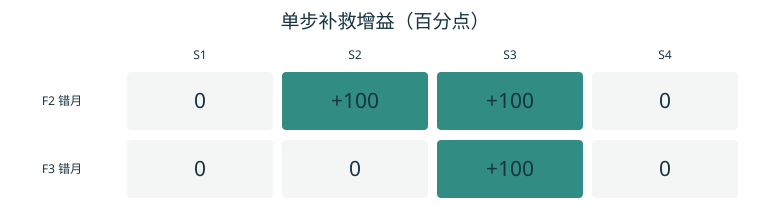

# 测试集实验结果

独立基础任务 24 个，主轨迹 72 条，注入后验收失败 48 条。生成了 216 份盲判输入，执行了 384 次确定性续跑。

## 1. 源头定位

准确率与覆盖率均以计划数为分母。明确给出 S2、S3 或无故障计入覆盖；有据命中要求标签正确，且所引字段真实可见，三个边界月份共同支持所指步骤。

| 诊断者 | 视图 | 轨迹 | 准确 | 有据命中 | 错指步骤 | 错判无故障 | 弃答 | 无效/缺失 | 覆盖 |
|---|---|---|---|---|---|---|---|---|---|
| 规则 | V0 | 干净 | 0/24（0%） | 0/24 | 0 | 0 | 24 | 0/0 | 0/24（0%） |
| 规则 | V0 | 注入 | 0/48（0%） | 0/48 | 0 | 0 | 48 | 0/0 | 0/48（0%） |
| 规则 | V1 | 干净 | 0/24（0%） | 0/24 | 0 | 0 | 24 | 0/0 | 0/24（0%） |
| 规则 | V1 | 注入 | 0/48（0%） | 0/48 | 0 | 0 | 48 | 0/0 | 0/48（0%） |
| 规则 | V2 | 干净 | 24/24（100%） | 24/24 | 0 | 0 | 0 | 0/0 | 24/24（100%） |
| 规则 | V2 | 注入 | 48/48（100%） | 48/48 | 0 | 0 | 0 | 0/0 | 48/48（100%） |

V0 给出请求与报告，V1 增加意图和数据库执行证据，V2 再增加工具出参月份。

规则在故障轨迹上，V2 相对 V1 的定位准确率差为 +100 个百分点，按基础任务配对重采样 2,000 次的 95% 区间为 [+100, +100] 个百分点。

**本次尚无真实模型盲判记录。**

## 2. 确定性单步补救

| 注入位置 | 替代位置 | 原动作成功 | 替代成功 | 增益（百分点） | 替代后停止提交 |
|---|---|---|---|---|---|
| F2 | S1 | 0/24（0%） | 0/24（0%） | +0 | 0 |
| F2 | S2 | 0/24（0%） | 24/24（100%） | +100 | 0 |
| F2 | S3 | 0/24（0%） | 24/24（100%） | +100 | 0 |
| F2 | S4 | 0/24（0%） | 0/24（0%） | +0 | 24 |
| F3 | S1 | 0/24（0%） | 0/24（0%） | +0 | 0 |
| F3 | S2 | 0/24（0%） | 0/24（0%） | +0 | 0 |
| F3 | S3 | 0/24（0%） | 24/24（100%） | +100 | 0 |
| F3 | S4 | 0/24（0%） | 0/24（0%） | +0 | 24 |

四个位置均已测完的轨迹有 48/48 条，其中零个有效位置 0 条，一个位置 24 条，多个位置 24/48（50%）。主动停止可以阻止错报，在统计交付的主指标中仍然算未成功。

## 3. 两种验收器

| 两月数字 | 实际查询 | 验收器 | 通过 | 拒绝 | 误放/适用样本 | 误拒/适用样本 |
|---|---|---|---|---|---|---|
| 不同 | 正确 | 只看数字 | 18 | 0 | — | 0/18（0%） |
| 不同 | 正确 | 含查询证据 | 18 | 0 | — | 0/18（0%） |
| 不同 | 错月 | 只看数字 | 0 | 36 | 0/36（0%） | — |
| 不同 | 错月 | 含查询证据 | 0 | 36 | 0/36（0%） | — |
| 相同 | 正确 | 只看数字 | 6 | 0 | — | 0/6（0%） |
| 相同 | 正确 | 含查询证据 | 6 | 0 | — | 0/6（0%） |
| 相同 | 错月 | 只看数字 | 12 | 0 | 12/12（100%） | — |
| 相同 | 错月 | 含查询证据 | 0 | 12 | 0/12（0%） | — |

前后两个月计数相同的比例由实验设计指定，仅用于检验数字验收器的盲点。

## 4. 真实执行复核

本次尚无真实执行 Agent 子集的初始运行汇总。

上述确定性枚举只覆盖已登记的四种单步干预和各步骤权限。
